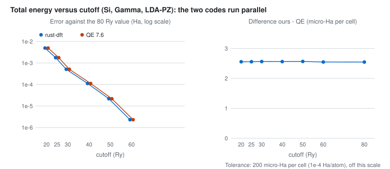
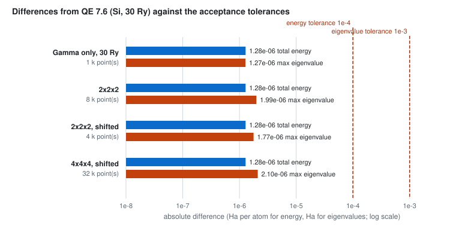
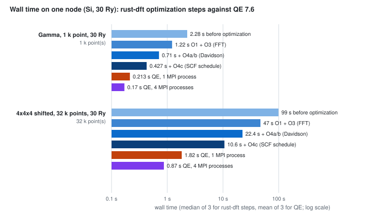

# BAANDI

**A modern, state-aware density functional theory engine for materials research.**

BAANDI is an experimental, open-source electronic structure engine written in Rust. It is being developed to explore new approaches to density functional theory (DFT), electronic-state exploration, and interoperability across computational scales.

The project begins with a plane-wave Kohn–Sham DFT implementation, with an emphasis on numerical correctness, modular architecture, and reproducible scientific computing.

Our longer-term ambition is to build an electronic structure engine that does more than converge to a single solution.

## Why BAANDI?

Conventional DFT workflows typically focus on obtaining a converged electronic structure for a given atomic configuration.

However, convergence does not necessarily imply that the lowest-energy electronic state has been found. Different initial conditions may lead to distinct self-consistent solutions, particularly in materials with complex magnetic, electronic, or charge-ordering behavior.

Furthermore, electronic structure calculations are increasingly used as components of larger computational workflows involving molecular dynamics, machine-learned interatomic potentials, electrochemical environments, and continuum-scale models.

BAANDI is designed with these challenges in mind.

Its development is guided by three principles:

### 1. A modern electronic structure foundation

Develop a modular plane-wave DFT engine using Rust, with clear separation between physical models, numerical algorithms, and computational backends.

Correctness, validation, and reproducibility take precedence over premature optimization.

### 2. Electronic-state landscape exploration

Move beyond the assumption that one converged SCF calculation is sufficient.

BAANDI aims to support the discovery, comparison, and tracking of distinct self-consistent electronic states, including metastable solutions where the underlying physical model permits them.

The objective is not to guarantee a global minimum, but to make the electronic-state landscape more accessible and systematically explorable.

### 3. Multiscale-ready scientific interfaces

Treat interoperability as an architectural requirement rather than an afterthought.

BAANDI aims to provide physically consistent interfaces for exchanging structures, electronic densities, potentials, energies, forces, stresses, and electronic-state metadata with external computational tools.

Potential applications include QM/MM coupling, explicit and implicit solvent environments, machine-learned interatomic potentials, and multiscale materials simulations.

BAANDI does not aim to replace specialized molecular dynamics, machine learning, or continuum simulation engines.

## Technical Direction

The initial implementation focuses on:

- Plane-wave basis sets and reciprocal-space operations
- Periodic boundary conditions and k-point sampling
- Norm-conserving pseudopotentials
- Local and nonlocal Hamiltonian operators
- Hartree and exchange-correlation potentials
- Kohn–Sham eigensolvers
- Self-consistent field calculations
- Validation against established electronic structure implementations

The architecture is intended to accommodate future developments in spin polarization, electronic-state exploration, forces and stresses, external-field coupling, and heterogeneous computing.

These are development directions, not claims of currently available functionality.

## Development Status

**BAANDI is in an early experimental stage.**

The initial numerical infrastructure and k-point functionality are under development and validation. A complete, production-ready DFT calculation workflow is not yet available.

The project should not currently be used for scientific conclusions or production calculations without independent validation.

Implementation progress and supported features will be documented as they become available.

Build instructions, example inputs, how to run the CLI and how the Quantum ESPRESSO comparisons are reproduced are in [docs/getting-started.md](docs/getting-started.md); the full documentation map is [docs/INDEX.md](docs/INDEX.md).

<!-- validation:begin -->

## Validation results

Generated by `scripts/make_readme_figures.py` from the stored evidence in `tests/reference` (do not edit by hand). Reference: Quantum ESPRESSO 7.6 run on a remote server (see [validation record](docs/validation.md)). Evidence covers one cell (Si diamond) and one pseudopotential of unverified provenance; it is not a statement about general material accuracy.

| Check (Si, 30 Ry, same pseudopotential for both codes) | k points | QE iterations | energy difference (Ha/atom) | largest eigenvalue difference (Ha) | tolerance (energy / eigenvalue) | status |
|---|---|---|---|---|---|---|
| LDA Gamma only | 1 | 11 | 1.28e-06 | 1.27e-06 | 1e-4 / 1e-3 | pass |
| LDA 2x2x2 | 8 | 9 | 1.28e-06 | 1.99e-06 | 1e-4 / 1e-3 | pass |
| LDA 2x2x2, shifted | 4 | 9 | 1.28e-06 | 1.77e-06 | 1e-4 / 1e-3 | pass |
| LDA 4x4x4, shifted | 32 | 8 | 1.28e-06 | 2.10e-06 | 1e-4 / 1e-3 | pass |
| PBE Gamma (override) | 1 | 12 | 1.70e-06 | 1.27e-06 | 1e-4 / 1e-3 | pass |
| PBE 2x2x2, shifted (override) | 4 | 9 | 1.69e-06 | 1.82e-06 | 1e-4 / 1e-3 | pass |

Cutoff scan: 7 cutoffs from 20 to 80 Ry; the energy difference to QE is the same at every cutoff (2.54 to 2.57 micro-Ha per cell), a constant offset explained by the G=0 local-potential integral convention (validation record R4). The 4x4x4 and PBE evidence are relayed text summaries; the other LDA runs are whole-file, hash-verified outputs. The PBE rows use QE's `input_dft = 'pbe'` override on the LDA pseudopotential: a code-to-code consistency test of the PBE implementation, not a physically meaningful PBE result for this pseudopotential.

### Performance (rust-dft optimization steps against QE 7.6, same node)

Same node (Intel Xeon Gold 6230 @ 2.10 GHz, 2 sockets x 20 cores, SMT on (80 logical)), rust-dft on one thread (steps measured with `scripts/bench_scf.py`, median of 3, quiet node) against QE 7.6 on one and on four MPI processes (mean of 3); latest step: commit `f6e3679`. Relayed measurements, see [validation record](docs/validation.md) R7 and the [optimization log](docs/performance/optimization-log.md). QE converges to a much tighter threshold (1e-12) than the rust-dft defaults, so compare iterations and final energies as well as times.

| Case | before optimization (s) | O1 + O3 (FFT) (s) | QE 1 process (s) | QE 4 processes (s) | latest vs QE 1 process | speedup vs before | iterations rust-dft / QE | diagonalization share |
|---|---|---|---|---|---|---|---|---|
| Gamma, 1 k point, 30 Ry (1 k) | 2.28 | 1.22 | 0.217 | 0.173 | 5.6x slower | 1.87x | 11 / 11 | 84% |
| 4x4x4 shifted, 32 k points, 30 Ry (32 k) | 99 | 47 | 1.82 | 0.88 | 25.9x slower | 2.11x | 11 / 8 | 95% |

Cross-platform check: the total energy on this Linux x86 build differs from the macOS Apple Silicon build by +8.88e-15 Ha (Gamma) and +0.00e+00 Ha (4x4x4, shifted).

Other verified results: PBE (xcx) matches the published closed forms to 2e-16 Ha and the LDA path is unchanged bit for bit; k-point engine at Gamma reproduces the previous density bit for bit; unit conversion through `uom` and arithmetic input expressions leave the real-Si density bit-identical; fast gates (`scripts/check.sh`) and the Python regression tests pass. Results are added here after each verified implementation.

<!-- validation:end -->

## Architecture Philosophy

BAANDI follows a few guiding rules:

- **Physics before performance.** Numerical correctness and physical consistency must be established before optimization.
- **Explicit scientific conventions.** Units, signs, coordinate systems, boundary conditions, and numerical assumptions should be documented.
- **Modularity without unnecessary abstraction.** Components should remain independently testable and replaceable.
- **Interoperability without dependency.** External scientific software should connect through well-defined interfaces rather than become embedded in the DFT core.
- **Reproducibility by design.** Calculations should preserve sufficient metadata to understand and reproduce their results.
- **No silent physical assumptions.** Distinct electronic states, approximations, and convergence limitations should be made visible.

## Implementation

BAANDI is written primarily in **Rust**.

Initial development targets CPU execution, including development and validation on Apple Silicon. Future computational backends may support GPU acceleration and distributed execution.

The implementation is being developed independently, with established electronic structure codes serving as scientific references for validation.

## AI-Assisted Development

BAANDI is being developed through an AI-assisted software engineering workflow.

Human contributors define scientific objectives, physical requirements, validation criteria, and architectural direction. AI coding agents participate in implementation, code review, testing, and documentation.

AI-generated code is subject to the same requirements for correctness, reproducibility, and scientific validation as human-written code.

The use of AI does not constitute evidence of numerical or physical correctness.

## The Name

**BAANDI** is inspired by *bandi* (반디), a Korean word associated with fireflies.

A small light can reveal something otherwise hidden.

The name reflects the project's ambition to illuminate electronic states and physical behavior that may be overlooked by conventional computational workflows.

## Roadmap

The broad development sequence is:

1. Establish and validate the foundational plane-wave DFT implementation.
2. Complete a reliable self-consistent electronic structure workflow.
3. Extend physical capabilities and validate energies, forces, and stresses.
4. Introduce systematic electronic-state exploration.
5. Develop general-purpose interfaces for external physical environments and multiscale coupling.
6. Investigate advanced numerical methods and accelerated computing backends.

The roadmap is exploratory and may change as the implementation and scientific requirements evolve.

## Contributing

BAANDI is an early-stage research software project.

Contribution guidelines, development documentation, and validation procedures will be published as the project matures.

## License

BAANDI is released under the [MIT License](LICENSE). The silicon pseudopotential used for internal validation is not part of the repository and is not covered by this license.

---

*BAANDI — Exploring matter beyond a single electronic state.*
