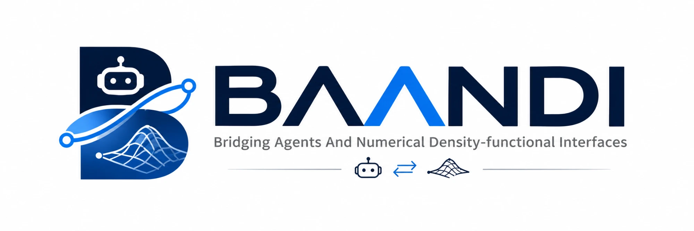

# BAANDI

**A modern, state-aware density functional theory engine for materials research.**

*BAANDI* stands for **B**ridging **A**gents **A**nd **N**umerical **D**ensity-functional **I**nterfaces.

BAANDI is an experimental, open-source electronic structure engine written in Rust. It is a plane-wave Kohn–Sham DFT code built so that people, scripts and AI agents can run, observe, control and verify a calculation through typed, documented interfaces, and so that the calculation can serve as a trustworthy component of larger scientific workflows.

The project starts from a plane-wave Kohn–Sham DFT implementation with an emphasis on numerical correctness, modular architecture and reproducibility. Its longer-term ambition is an electronic structure engine that does more than converge to a single solution, and whose calculations are not black boxes.

## Why BAANDI?

Conventional DFT workflows run a calculation to the end and hand back a converged electronic structure for one atomic configuration. Three things are missing from that picture.

**Convergence is not the whole story.** A converged SCF run is not necessarily the lowest-energy electronic state. Different initial conditions can lead to distinct self-consistent solutions, particularly for complex magnetic, electronic or charge-ordering behavior.

**A calculation is a process, not a single call.** SCF runs stagnate, oscillate or diverge, and today the usual remedy is to kill the job and start over by hand. The state of a running calculation is rarely observable, and it cannot be changed safely while it runs.

**DFT is increasingly a component.** Electronic structure calculations feed molecular dynamics, machine-learned interatomic potentials, electrochemical environments, solvent models and continuum-scale models, and AI agents are starting to drive them. Those consumers need physically consistent, machine-readable interfaces.

BAANDI is designed with these challenges in mind. Its development is guided by four principles.

### 1. A modern electronic structure foundation

A modular plane-wave DFT engine in Rust, with clear separation between physical models, numerical algorithms and computational backends. Correctness, validation and reproducibility take precedence over premature optimization, and no tolerance is relaxed to make a test pass.

### 2. Electronic-state landscape exploration

Move beyond the assumption that one converged SCF calculation is sufficient. BAANDI aims to support the discovery, comparison and tracking of distinct self-consistent electronic states, including metastable solutions where the physical model permits them. The objective is not to guarantee a global minimum, but to make the electronic-state landscape accessible and systematically explorable.

### 3. Multiscale-ready scientific interfaces

Interoperability is an architectural requirement. BAANDI aims to exchange structures, densities, potentials, energies and electronic-state metadata (and forces and stresses once they exist) with external tools through physically consistent interfaces: QM/MM coupling, explicit and implicit solvents, machine-learned interatomic potentials, multiscale simulations. External methods connect through adapters and drivers outside the numerical core. BAANDI does not aim to replace specialized molecular dynamics, machine learning or continuum engines.

### 4. An observable, controllable, agent-native runtime

The numerical core knows nothing about language models, networks or tool protocols. Around it, BAANDI is being built as layers:

| Layer | Role |
|---|---|
| A. Numerical core | Plane-wave DFT, no LLM, MCP or HTTP dependencies |
| B. Typed scientific state | Units, metadata and schema versions on everything that leaves the core |
| C. Runtime control | Stepwise execution, state machine, pause/resume, checkpoint/restart, event stream, policy changes at safe points |
| D. Integration | Python/ASE, MLIP adapters, external numerical solvers |
| E. Agent tools | A thin MCP server with typed tools, quotas and an audit log |

Rules that hold for every layer: the stepwise path must give bit-identical results to the conventional path; a change to a running calculation is validated, applied only between SCF iterations, rejected without side effects if unsafe, and recorded; convergence is declared only by the existing fixed-point certificate, never by the control layer; diagnostics separate measured evidence from hypothesis. The first end-to-end demonstration is a **self-healing SCF**: a failing calculation is diagnosed, repaired through a validated policy change, continued and verified, with the intervention recorded. Design and plan: [docs/research/agent-native-directive-review.md](docs/research/agent-native-directive-review.md) and the P11 tickets; none of layers B to E exists yet.

## Technical Direction

The current implementation covers:

- Plane-wave basis sets and reciprocal-space operations
- Periodic boundary conditions and Monkhorst–Pack k-point sampling (time-reversal symmetry only)
- Norm-conserving pseudopotentials (UPF v2 subset)
- Local and nonlocal Hamiltonian operators
- Hartree and exchange-correlation potentials (LDA, and PBE through a library)
- Block-Davidson Kohn–Sham eigensolver, Pulay density mixing, a fixed-point convergence certificate and an energy audit
- Deterministic multithreading (results identical for every thread count)
- Validation against Quantum ESPRESSO (see the results below)

In design or development: richer SCF algorithms and an optional Intel MKL backend selected at compile time, band-structure/DOS and volumetric outputs in standard formats, electronic-state exploration, forces and stresses, external-field coupling, spin polarization, GPU backends, and the agent-native runtime above.

These are development directions, not claims of currently available functionality; the status table below is the authoritative list.

## Development Status

**BAANDI is in an early experimental stage.** A verified silicon-class workflow exists (insulators, fixed occupations, LDA and PBE, Gamma and k-point meshes), but it is not a production DFT code. It should not be used for scientific conclusions without independent validation. Features such as metals/smearing, forces, stress, spin and structure relaxation are not available yet.

Build instructions, example inputs, how to run the CLI and how the Quantum ESPRESSO comparisons are reproduced are in [docs/getting-started.md](docs/getting-started.md); the full documentation map is [docs/INDEX.md](docs/INDEX.md).

<!-- status:begin -->

## What BAANDI can do today

Status as of 2026-11-03, written for people who run calculations. Source: `docs/feature-status.json` (this section is generated by `scripts/make_readme_figures.py`).

**You can use it today for:** Total energy, eigenvalues and electron density of insulating periodic systems with LDA or PBE, on Gamma or a k mesh. Reproducible runs: the result files carry hashes, options and the energy audit.

**Not available yet:** Metals (no smearing), magnetic systems, most transition-metal oxides (they need nonlinear core correction, spin and often +U). Forces and relaxations, symmetry reduction, hybrid functionals.

**Speed:** Performance comparisons with other codes are being re-measured under matched conditions (same server, same numerical libraries, same accuracy class) and will be added here; no speed claim is made until then.

### Works today

| Area | Feature | Notes |
|---|---|---|
| Physics | Kohn-Sham DFT with plane waves | Periodic cells, norm-conserving pseudopotentials (UPF v2 subset), spin-unpolarized. |
| Physics | LDA (Perdew-Zunger) and PBE (GGA) | PBE comes from the xcx library; tested against QE on the same pseudopotential. |
| Physics | Insulators with fixed occupations | The sampled band gap is checked; partial occupations are refused on purpose (no smearing yet). |
| k points | Gamma, Monkhorst-Pack grids (shifted or not), explicit k lists | Time-reversal reduction only; no space-group symmetry reduction yet. |
| SCF | Pulay and linear density mixing, block Davidson eigensolver | Every run ends with a fixed-point certificate and a term-by-term energy audit. |
| Input | One TOML file; units (Ha, Ry, eV, Angstrom, Bohr, ...) and expressions such as 1/4 or 5.43/2 Angstrom | Wrong inputs are rejected with the key path of the problem. |
| Output | results.json (energies, eigenvalues, convergence history, provenance) and the electron density (binary + metadata) | Every run records input and pseudopotential hashes. |
| Speed | Threads over k points and over bands, bit-identical results for any thread count | `[scf] threads = N`; default is 1. |
| Validation | Agrees with Quantum ESPRESSO 7.6 on silicon (energies, eigenvalues, k grids, PBE) | See the validation results below. One cell and one pseudopotential so far. |

### Being built now

| Area | Feature | Notes |
|---|---|---|
| Output | Band structures and density of states (CSV, SVG figure, QE-/VASP-style files) | Plot-ready files for people who do not code. |
| Output | Electron density, ELF and potentials as cube, XSF, CHGCAR and VTK files | Opens in VESTA, VMD, ParaView and similar viewers. |
| Robustness | Convergence fix for larger cells (8-atom silicon cell stalled at the default settings) | Found by a stress test; the fix treats the highest requested bands as loosely converged buffer bands. |
| Usability | Input preflight check: element versus pseudopotential, SCF settings, plain-language summary of what will be computed | Closes a gap where a wrong pseudopotential could run without a warning. |
| Speed | Optional Intel MKL backend for FFT and matrix products, chosen at compile time | Selected at compile time; the default build stays pure Rust. Kernel-level measurements on the test server look promising; end-to-end numbers follow. |
| Speed | Cheaper FFT call structure for the wavefunction path; RMM-DIIS eigensolver for large band counts; Kerker-preconditioned mixing for hard cases | Developed as switchable modules; defaults change only with evidence on several systems. |
| Usability | Structure and input importers, Materials Project lookup, pseudopotential download with license and hash checks, a guided or natural-language style CLI | In design now. |
| Infrastructure | General benchmark and robustness suite (not silicon-only) | Used to judge speed and defaults on many cell shapes, band counts and pseudopotentials. |

### Planned, not available yet

| Area | Feature | Notes |
|---|---|---|
| Physics | Metals: smearing, Fermi level | Needed for aluminum, iron and most alloys. |
| Physics | Magnetism: spin-polarized LSDA and spin GGA, then noncollinear and spin-orbit | Needed for transition-metal oxides and cathodes. |
| Physics | DFT+U, meta-GGA, hybrid functionals, dispersion corrections | Roadmap and validation oracles are in docs/research/xc-and-manybody-roadmap.md. |
| Physics | Nonlinear core correction, ultrasoft and PAW pseudopotentials | Most transition-metal pseudopotentials need at least nonlinear core correction. |
| Physics | Forces, stress, structure relaxation, molecular dynamics, phonons | Hellmann-Feynman forces come first. |
| Physics | Space-group symmetry (k-point reduction, density symmetrization) | Large speedup for crystals with many k points. |
| Physics | RPA and cRPA correlation (research stage) | Design only; no implementation yet. |
| Method | Electronic-state landscape exploration: several self-consistent solutions, state comparison, branch tracking | Design in docs/roadmap/esle.md; starts after the baseline is complete. |
| Method | Coupling to outside environments (embedding, solvent, QM/MM, applied electric fields) through typed interfaces | Design in docs/architecture/scientific-coupling.md. |
| Speed | GPU backends and MPI | Design study in progress; the CPU path stays the reference. |

<!-- status:end -->

<!-- validation:begin -->

## Validation results

Generated by `scripts/make_readme_figures.py` from the stored evidence in `tests/reference` (do not edit by hand). Reference: Quantum ESPRESSO 7.6 run on a remote server (see [validation record](docs/validation.md)). Evidence covers one cell (Si diamond) and one pseudopotential of unverified provenance; it is not a statement about general material accuracy.

| Check (Si, 30 Ry, same pseudopotential for both codes) | k points | QE iterations | energy difference (Ha/atom) | largest eigenvalue difference (Ha) | tolerance (energy / eigenvalue) | status |
|---|---|---|---|---|---|---|
| LDA Gamma only | 1 | 11 | 1.28e-06 | 1.27e-06 | 1e-4 / 1e-3 | pass |
| LDA 2x2x2 | 8 | 9 | 1.28e-06 | 1.99e-06 | 1e-4 / 1e-3 | pass |
| LDA 2x2x2, shifted | 4 | 9 | 1.28e-06 | 1.77e-06 | 1e-4 / 1e-3 | pass |
| LDA 4x4x4, shifted | 32 | 8 | 1.28e-06 | 2.10e-06 | 1e-4 / 1e-3 | pass |
| PBE Gamma (override) | 1 | 12 | 1.70e-06 | 1.27e-06 | 1e-4 / 1e-3 | pass |
| PBE 2x2x2, shifted (override) | 4 | 9 | 1.69e-06 | 1.82e-06 | 1e-4 / 1e-3 | pass |

Cutoff scan: 7 cutoffs from 20 to 80 Ry; the energy difference to QE is the same at every cutoff (2.54 to 2.57 micro-Ha per cell), a constant offset explained by the G=0 local-potential integral convention (validation record R4). The 4x4x4 and PBE evidence are relayed text summaries; the other LDA runs are whole-file, hash-verified outputs. The PBE rows use QE's `input_dft = 'pbe'` override on the LDA pseudopotential: a code-to-code consistency test of the PBE implementation, not a physically meaningful PBE result for this pseudopotential.

Other verified results: PBE (xcx) matches the published closed forms to 2e-16 Ha and the LDA path is unchanged bit for bit; k-point engine at Gamma reproduces the previous density bit for bit; unit conversion through `uom` and arithmetic input expressions leave the real-Si density bit-identical; fast gates (`scripts/check.sh`) and the Python regression tests pass. Results are added here after each verified implementation.

<!-- validation:end -->

## Architecture Philosophy

- **Physics before performance.** Numerical correctness and physical consistency are established before optimization; every optimization is measured and recorded.
- **Explicit scientific conventions.** Units, signs, coordinate systems, boundary conditions and numerical assumptions are documented.
- **Modularity without unnecessary abstraction.** Components stay independently testable and replaceable.
- **Interoperability without dependency.** External software, including AI agents, connects through well-defined interfaces outside the DFT core.
- **Observable and controllable, but never silently.** Anything that changes a running calculation is typed, validated, applied at a safe point and recorded.
- **Reproducibility by design.** Calculations preserve the metadata needed to understand and reproduce them.
- **No silent physical assumptions.** Distinct electronic states, approximations and convergence limits are made visible.
- **General-purpose, not a silicon code.** Defaults and algorithms are accepted on evidence from varied systems, not from one benchmark.
- **Open formats first.** Results are written in standard, widely readable formats and in the conventions of established codes where they exist.

## Implementation

BAANDI is written in **Rust**. Development and validation run on Apple Silicon, and validation against Quantum ESPRESSO runs on a Linux server. The default build is pure Rust; an optional Intel MKL backend is selected at compile time and is not redistributed. GPU backends are a design topic, not code.

The implementation is developed independently. Established codes serve as scientific references for validation; their source is not copied, and pseudopotential files are not part of the repository.

## AI-Assisted Development

BAANDI is developed through an AI-assisted workflow with defined roles: humans set scientific objectives, validation criteria and architectural direction and give final approval; one AI agent acts as architect and reviewer; other AI agents implement tickets in isolated branches. Every claim of completion is checked by running the gates (`scripts/check.sh`) and reporting real exit codes and numbers. Tickets, decisions (ADRs), validation records and agent run logs are kept in the repository.

AI-generated code is held to the same standard of correctness, reproducibility and scientific validation as human-written code. The use of AI does not constitute evidence of numerical or physical correctness.

BAANDI is also being built to be driven by agents, which is a separate matter: the controllable runtime described above gives agents a safe, auditable way to operate calculations.

## The Name

**BAANDI** stands for **B**ridging **A**gents **A**nd **N**umerical **D**ensity-functional **I**nterfaces. It is also inspired by *bandi* (반디), the Korean word for firefly: a small light can reveal something otherwise hidden. The name reflects the ambition to illuminate electronic states and calculation behavior that conventional workflows overlook, and to connect people, agents and numerical methods.

## Roadmap

1. Establish and validate the foundational plane-wave DFT implementation (done for the silicon-class insulating case).
2. Complete a reliable, general self-consistent workflow: robust SCF, performance, standard output formats, input checks.
3. Observable and controllable runtime: stepwise SCF, events, checkpoint/restart, safe policy changes, SCF diagnostics, self-healing demonstration.
4. Agent and ecosystem interfaces: MCP server, Python/ASE, external numerical solver contracts.
5. Extend physical capabilities and validate energies, forces and stresses.
6. Systematic electronic-state exploration and coupling to external physical environments (QM/MM, solvation, MLIP workflows).
7. Advanced numerical methods and accelerated backends.

The order is exploratory and may change with the implementation and scientific requirements. Detailed plans: [docs/roadmap/](docs/roadmap/).

## Contributing

BAANDI is an early-stage research software project. Development is public: issues and pull requests are on GitHub. Start with [AGENTS.md](AGENTS.md) and [docs/INDEX.md](docs/INDEX.md) (read order, ownership, ticket format, verification gates). Contributions must pass `scripts/check.sh` and keep the validation evidence honest.

## License

BAANDI is released under the [MIT License](LICENSE). The silicon pseudopotential used for internal validation is not part of the repository and is not covered by this license.

---

*BAANDI: bridging agents and numerical density-functional interfaces, to explore matter beyond a single electronic state.*
