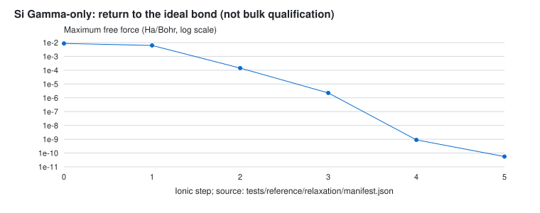

# BAANDI

**A modern, state-aware density functional theory engine for materials research.**

*BAANDI* stands for **B**ridging **A**gents **A**nd **N**umerical **D**ensity-functional **I**nterfaces.

BAANDI is an experimental, open-source electronic structure engine written in Rust. It is a plane-wave Kohn–Sham DFT code built so that people, scripts and AI agents can run, observe, control and verify a calculation through typed, documented interfaces, and so that the calculation can serve as a trustworthy component of larger scientific workflows.

The project starts from a plane-wave Kohn–Sham DFT implementation with an emphasis on numerical correctness, modular architecture and reproducibility. Its longer-term ambition is an electronic structure engine that does more than converge to a single solution, and whose calculations are not black boxes.

## Why BAANDI?

Conventional DFT workflows run a calculation to the end and hand back a converged electronic structure for one atomic configuration. Three things are missing from that picture.

**Convergence is not the whole story.** A converged SCF run is not necessarily the lowest-energy electronic state. Different initial conditions can lead to distinct self-consistent solutions, particularly for complex magnetic, electronic or charge-ordering behavior.

**A calculation is a process, not a single call.** SCF runs stagnate, oscillate or diverge, and today the usual remedy is to kill the job and start over by hand. The state of a running calculation is rarely observable, and it cannot be changed safely while it runs.

**DFT is increasingly a component.** Electronic structure calculations feed molecular dynamics, machine-learned interatomic potentials, electrochemical environments, solvent models and continuum-scale models, and AI agents are starting to drive them. Those consumers need physically consistent, machine-readable interfaces.

BAANDI is designed with these challenges in mind. Its development is guided by four principles.

### 1. A modern electronic structure foundation

A modular plane-wave DFT engine in Rust, with clear separation between physical models, numerical algorithms and computational backends. Correctness, validation and reproducibility take precedence over premature optimization, and no tolerance is relaxed to make a test pass.

### 2. Electronic-state landscape exploration

Move beyond the assumption that one converged SCF calculation is sufficient. BAANDI aims to support the discovery, comparison and tracking of distinct self-consistent electronic states, including metastable solutions where the physical model permits them. The objective is not to guarantee a global minimum, but to make the electronic-state landscape accessible and systematically explorable.

### 3. Multiscale-ready scientific interfaces

Interoperability is an architectural requirement. BAANDI aims to exchange structures, densities, potentials, energies and electronic-state metadata (and forces and stresses once they exist) with external tools through physically consistent interfaces: QM/MM coupling, explicit and implicit solvents, machine-learned interatomic potentials, multiscale simulations. External methods connect through adapters and drivers outside the numerical core. BAANDI does not aim to replace specialized molecular dynamics, machine learning or continuum engines.

### 4. An observable, controllable, agent-native runtime

The numerical core knows nothing about language models, networks or tool protocols. Around it, BAANDI is being built as layers:

| Layer | Role |
|---|---|
| A. Numerical core | Plane-wave DFT, no LLM, MCP or HTTP dependencies |
| B. Typed scientific state | Units, metadata and schema versions on everything that leaves the core |
| C. Runtime control | Stepwise execution, state machine, pause/resume, checkpoint/restart, event stream, policy changes at safe points |
| D. Integration | Python/ASE, MLIP adapters, external numerical solvers |
| E. Agent tools | A thin MCP server with typed tools, quotas and an audit log |

Rules that hold for every layer: the stepwise path must give bit-identical results to the conventional path; a change to a running calculation is validated, applied only between SCF iterations, rejected without side effects if unsafe, and recorded; convergence is declared only by the existing fixed-point certificate, never by the control layer; diagnostics separate measured evidence from hypothesis. The first end-to-end demonstration is a **self-healing SCF**: a failing calculation is diagnosed, repaired through a validated policy change, continued and verified, with the intervention recorded. Design and plan: [docs/research/agent-native-directive-review.md](docs/research/agent-native-directive-review.md) and the P11 tickets; none of layers B to E exists yet.

## Technical Direction

The current implementation covers:

- Plane-wave basis sets and reciprocal-space operations
- Periodic boundary conditions and Monkhorst–Pack k-point sampling (time-reversal symmetry only)
- Norm-conserving pseudopotentials (UPF v2 subset)
- Local and nonlocal Hamiltonian operators
- Hartree and exchange-correlation potentials (LDA, and PBE through a library)
- Block-Davidson Kohn–Sham eigensolver, Pulay density mixing, a fixed-point convergence certificate and an energy audit
- Deterministic multithreading (results identical for every thread count)
- Validation against Quantum ESPRESSO (see the results below)

In design or development: richer SCF algorithms and an optional Intel MKL backend selected at compile time, band-structure/DOS and volumetric outputs in standard formats, electronic-state exploration, forces and stresses, external-field coupling, spin polarization, GPU backends, and the agent-native runtime above.

These are development directions, not claims of currently available functionality; the status table below is the authoritative list.

## Development Status

**BAANDI is in an early experimental stage.** A verified silicon-class workflow exists (insulators, fixed occupations, LDA and PBE, Gamma and k-point meshes), but it is not a production DFT code. It should not be used for scientific conclusions without independent validation. Features such as metals/smearing, forces, stress, spin and structure relaxation are not available yet.

Build instructions, example inputs, how to run the CLI and how the Quantum ESPRESSO comparisons are reproduced are in [docs/getting-started.md](docs/getting-started.md); the full documentation map is [docs/INDEX.md](docs/INDEX.md).

<!-- status:begin -->

## What BAANDI can do today

Status as of 2026-11-03, written for people who run calculations. Source: `docs/feature-status.json` (this section is generated by `scripts/make_readme_figures.py`).

**You can use it today for:** Total energy, eigenvalues and electron density of insulating periodic systems with LDA or PBE, on Gamma or a k mesh. Reproducible runs: the result files carry hashes, options and the energy audit.

**Not available yet:** Validated magnetic and metallic material accuracy; DFT+U for correlated transition-metal oxides. Spin, NLCC and Fermi-Dirac options have limited validation below. Spin-polarized or finite-temperature relaxation in the CLI, DFT+U forces, standard-profile stress, molecular dynamics, phonons and hybrid functionals.

**Speed:** Measured on one server (dev08, 2 x Xeon Gold 6230, Rocky Linux 9.7, one socket, Intel MKL 2026.1 linked in both codes, same silicon pseudopotential and FFT grid; QE 7.6 with MPI, one thread per process), same session and idle node, 2026-11-05, BAANDI commit fdce016 for the k-point mesh and the later commit 7fe2e9a for the 8-atom cell (the k-point results did not change between them). Ratios are BAANDI time over QE time, so above 1 means BAANDI is slower. Silicon with a 4x4x4 shifted k mesh (2 atoms): at 8 to 16 cores 2.0 to 2.2 times slower than QE at convergence threshold 1e-8 and 1.4 to 1.6 times slower at 1e-12 (QE needs 8 instead of 5 iterations at 1e-12; both are reported because the ratio depends on it); on one core 4.2 to 5.1 times (1e-8). An 8-atom cell at Gamma only (one k point): against QE's complex k=0 path (`K_POINTS automatic 1 1 1`) BAANDI is 5.3 to 8.0 times slower on one core and 13 to 15 times slower at 16 cores; against QE's real-wavefunction Gamma path (`K_POINTS gamma`, QE's best configuration for this case, 1.3 to 1.9 times faster than its complex path and the reference for the goal of exceeding QE) BAANDI is 9.6 to 14.9 times slower on one core (1e-12 and 1e-8 convergence thresholds; MKL and pure Rust builds), (a machine-tuned build, `target-cpu=native`, makes the pure Rust build 1.1 to 1.4 times faster on dev08 with bit-identical results, bringing the one-core ratio to QE's real Gamma path down to 11.3; the ratios above use the default portable build) because BAANDI's threading speeds this case up only 1.4 times at 8 threads, it has no real-wavefunction Gamma path yet, and it performs more eigensolver work per SCF iteration; this is the main known weakness and is being worked on. Cases where QE takes under 0.3 s are excluded: QE's timer resolves only 0.01 s. The numbers were relayed from the measuring session and have not been independently reproduced here; build hashes, raw tables and limits: tests/reference/perf/dev08_final_relayed.md.

### Works today

| Area | Feature | Notes |
|---|---|---|
| Physics | Kohn-Sham DFT with plane waves | Periodic cells, norm-conserving pseudopotentials (UPF v2 subset), spin-unpolarized. |
| Physics | LDA (Perdew-Zunger) and PBE (GGA) | PBE comes from the xcx library; tested against QE on the same pseudopotential. |
| Physics | Insulators with fixed occupations | Fixed occupations require a sampled band gap. Use the separate Fermi-Dirac option for partial occupations. |
| k points | Gamma, Monkhorst-Pack grids (shifted or not), explicit k lists | Time reversal and opt-in crystal symmetry reduction; only model-, mesh- and FFT-grid-preserving operations. [Evidence](tests/reference/symmetry/evidence.json). |
| SCF | Pulay and linear density mixing, block Davidson eigensolver | Strict runs use a fixed-point certificate and energy audit. Opt-in standard results are not certified. |
| Input | One TOML file; units (Ha, Ry, eV, Angstrom, Bohr, ...) and expressions such as 1/4 or 5.43/2 Angstrom | Wrong inputs are rejected with the key path of the problem. |
| Output | results.json (energies, eigenvalues, convergence history, provenance) and the electron density (binary + metadata) | Every run records input and pseudopotential hashes. |
| Speed | Threads over k points and over bands, bit-identical results for any thread count | `[scf] threads = N`; default is 1. |
| Validation | Agrees with Quantum ESPRESSO 7.6 on silicon (energies, eigenvalues, k grids, PBE) | See the validation results below. One cell and one pseudopotential so far. |
| Output | Band structures and density of states (CSV, SVG figure, QE-/VASP-style files) | `bands` and `dos` subcommands: CSV, SVG, QE- and VASP-style files. Fixed-density non-self-consistent calculation; checked by the repository tests. |
| Output | Electron density, ELF and potentials as cube, XSF, CHGCAR and VTK files | Cube, XSF, CHGCAR and VTK writers; opens in VESTA, VMD, ParaView and similar viewers. Checked against format specifications in tests. |
| Robustness | Convergence fix for larger cells (8-atom silicon cell stalled at the default settings) | Buffer bands: the highest requested bands are loosely converged; strict bands keep the full tolerance. The 8-atom silicon cell now converges. |
| Usability | Input preflight check: element versus pseudopotential, SCF settings, plain-language summary of what will be computed | `validate` checks element versus pseudopotential and SCF settings and prints a plain-language summary; no SCF is run. |
| Input | Offline pseudopotential registry with license and SHA-256 checks | `pseudo` subcommands; pseudopotential files are never shipped in the repository. |
| Physics | Fermi-Dirac occupations and chemical potential | Unpolarized and collinear finite-temperature SCF; analytic synthetic oracles and an Al smoke run, no QE metal comparison. Check empty-band convergence; finite-T restart unavailable. [Evidence](tests/reference/occupations/summary.json). |
| Physics | Collinear spin with fixed up/down electron counts | LDA-PW and PBE; synthetic analytic and zero-moment oracles. No validated magnetic material ground state; noncollinear and spin-orbit remain unavailable. [Evidence](crates/dft-engine/tests/collinear-evidence.json). |
| Physics | Nonlinear core correction and PseudoDojo NC file support | Independent header checks and synthetic NLCC oracles; Si/MgO bulk smoke, comparison with QE pending. Datasets remain unqualified; ultrasoft and PAW unavailable. [Evidence](tests/reference/datasets/p13c-status.json). |
| Physics | Atomic forces | Strict NC LDA/PBE, NLCC, fixed spin and Fermi-Dirac; energy finite differences and independent scalar checks. DFT+U forces unsupported; comparison with QE pending. [Evidence](tests/reference/forces/manifest.json). |
| Physics | Space-group symmetry (k-point reduction, density symmetrization) | Opt-in k-point reduction and density symmetrization; full/reduced, spin and finite-temperature checks. Magnetic spin swaps unsupported; comparison with QE pending. [Evidence](tests/reference/symmetry/evidence.json). |
| SCF | Opt-in standard convergence profile | Strict remains default. Standard reduces solver work in stored successful cases but is not certified; skew/slab/mesh failures remain. [Evidence](tests/reference/perf/p17a/final-report.json). |
| Physics | Stress and pressure | Strict NC frozen-basis strain derivatives; ASE strain check and separate Pulay estimate. Standard profile unsupported; real Si/MgO material stresses inconclusive; comparison with QE pending. [Evidence](tests/reference/stress/validation.json). |
| Physics | Fixed-cell ionic relaxation | BFGS/FIRE, Cartesian constraints, warm starts and byte-identical restart. CLI spin-polarized and finite-temperature relaxation unsupported; Gamma-only MgO is not bulk qualification; comparison with QE pending. [Evidence](tests/reference/relaxation/manifest.json). |
| Physics | Cell relaxation | Works for the stated synthetic cases and isotropic PseudoDojo Si/MgO shifted-mesh runs, with limits: rebuild plus fresh-basis polish verifies start agreement and final pressure. Full-tensor symmetry preservation on shifted meshes and cutoff convergence are not established; comparison with QE pending. [Evidence](tests/reference/relaxation/cell/validation.json). |

### Being built now

| Area | Feature | Notes |
|---|---|---|
| Speed | Optional Intel MKL backend for FFT and matrix products, chosen at compile time | Merged behind a compile-time feature; the default build stays pure Rust. Kernel-level measurements on the test server look promising; end-to-end numbers follow. |
| Speed | RMM-DIIS eigensolver for large band counts and Kerker-preconditioned mixing for hard cases (merged as switchable modules); cheaper FFT call structure (in progress) | Defaults are unchanged; a default changes only with evidence on several systems. |
| Usability | Structure and input importers, Materials Project lookup, pseudopotential download with license and hash checks, a guided or natural-language style CLI | In design now. |
| Infrastructure | General benchmark and robustness suite (not silicon-only) | Used to judge speed and defaults on many cell shapes, band counts and pseudopotentials. |
| Runtime | Observable, controllable calculations for people and AI agents: step-by-step SCF, live events, safe-point policy changes, checkpoint/restart, self-healing SCF demo, MCP server, Python/ASE | Design in progress (docs/research/agent-native-directive-review.md); no runtime code yet. The numerical core stays free of LLM and network dependencies. |

### Planned, not available yet

| Area | Feature | Notes |
|---|---|---|
| Physics | DFT+U, meta-GGA, hybrid functionals, dispersion corrections | Roadmap and validation oracles are in docs/research/xc-and-manybody-roadmap.md. |
| Physics | RPA and cRPA correlation (research stage) | Design only; no implementation yet. |
| Method | Electronic-state landscape exploration: several self-consistent solutions, state comparison, branch tracking | Design in docs/roadmap/esle.md; starts after the baseline is complete. |
| Method | Coupling to outside environments (embedding, solvent, QM/MM, applied electric fields) through typed interfaces | Design in docs/architecture/scientific-coupling.md. |
| Speed | GPU backends and MPI | Design study in progress; the CPU path stays the reference. |
| Physics | Molecular dynamics and phonons | Planned; not available yet. |

<!-- status:end -->

<!-- validation:begin -->

## Validation results

Generated by `scripts/make_readme_figures.py` from stored evidence in `tests/reference` and the linked collinear report (do not edit by hand). Reference: Quantum ESPRESSO 7.6 run on a remote server (see [validation record](docs/validation.md)). The QE comparison below covers one cell (Si diamond) and one pseudopotential of unverified provenance; it is not a statement about general material accuracy.

| Check (Si, 30 Ry, same pseudopotential for both codes) | k points | QE iterations | energy difference (Ha/atom) | largest eigenvalue difference (Ha) | tolerance (energy / eigenvalue) | status |
|---|---|---|---|---|---|---|
| LDA Gamma only | 1 | 11 | 1.28e-06 | 1.27e-06 | 1e-4 / 1e-3 | pass |
| LDA 2x2x2 | 8 | 9 | 1.28e-06 | 1.99e-06 | 1e-4 / 1e-3 | pass |
| LDA 2x2x2, shifted | 4 | 9 | 1.28e-06 | 1.77e-06 | 1e-4 / 1e-3 | pass |
| LDA 4x4x4, shifted | 32 | 8 | 1.28e-06 | 2.10e-06 | 1e-4 / 1e-3 | pass |
| PBE Gamma (override) | 1 | 12 | 1.70e-06 | 1.27e-06 | 1e-4 / 1e-3 | pass |
| PBE 2x2x2, shifted (override) | 4 | 9 | 1.69e-06 | 1.82e-06 | 1e-4 / 1e-3 | pass |

Cutoff scan: 7 cutoffs from 20 to 80 Ry; the energy difference to QE is the same at every cutoff (2.54 to 2.57 micro-Ha per cell), a constant offset explained by the G=0 local-potential integral convention (validation record R4). The 4x4x4 and PBE evidence are relayed text summaries; the other LDA runs are whole-file, hash-verified outputs. The PBE rows use QE's `input_dft = 'pbe'` override on the LDA pseudopotential: a code-to-code consistency test of the PBE implementation, not a physically meaningful PBE result for this pseudopotential.

### Collinear spin: fixed up/down electron counts

LDA-PW and PBE synthetic checks: 23 zero-moment calculations reproduce the unpolarized engine with maximum energy difference 6.66e-15 Ha and density distance 6.04e-14 Bohr^-3/2. The remaining 1 case gives the same noninsulating rejection. Independent analytic exchange/PW92 formulas give maximum energy error 7.08e-15 Ha/electron; finite-difference potentials differ by at most 1.39e-11 Ha. These test fixed spin populations, not a magnetic material ground state or agreement with QE. [`crates/dft-engine/tests/collinear-evidence.json`](crates/dft-engine/tests/collinear-evidence.json).

### Nonlinear core correction and PseudoDojo files

Rust and independent Python header readers agree for 5 files (O, Ni, Al, Mg, Si). Header identity is not dataset qualification. [`tests/reference/datasets/pseudodojo-headers.json`](tests/reference/datasets/pseudodojo-headers.json).

Synthetic Gaussian core transforms match the analytic formula to 8.33e-16 relative error; localized XC potentials match finite differences to 7.25e-12 Ha. The later density-floor derivative check has maximum error 2.23e-10 Ha Bohr^3. [`tests/reference/datasets/p13c-status.json`](tests/reference/datasets/p13c-status.json); [`tests/reference/materials/verification.json`](tests/reference/materials/verification.json).

Limits: translating the synthetic PBE cell changes the energy by 3.08e-06 Ha on the coarse grid (fails the 1e-07 Ha cap), falling to 5.17e-09 Ha with grid refinement. The stored isolated-atom runs include failures; all datasets remain unqualified for transferability, ghost states and cutoff convergence. NLCC checkpoint persistence remains unavailable; validated NC force/stress derivatives are reported below.

### Real-material bulk runs: Si and MgO

PBE calculations with external PseudoDojo files, positive uniform starting density. These are successful calculation checks, not an independent accuracy reference; comparison with QE pending for Si and MgO. [`tests/reference/materials/results.json`](tests/reference/materials/results.json).

| Case | Cutoff (Ha) | SCF iterations | Total energy (Ha/cell) | Electron-count error | Indirect gap (Ha) |
|---|---:|---:|---:|---:|---:|
| si-20 | 20 | 15 | -8.462317836906 | 5.86e-14 | 0.043357 |
| si-30 | 30 | 15 | -8.462329006518 | 3.91e-14 | 0.043356 |
| si-40 | 40 | 15 | -8.462336822427 | 1.07e-14 | 0.043357 |
| mgo-40 | 40 | 18 | -76.050880851711 | 1.60e-13 | 0.234595 |
| mgo-50 | 50 | 19 | -76.050969240430 | 2.84e-14 | 0.234593 |
| mgo-60 | 60 | 19 | -76.050977170773 | 1.81e-13 | 0.234592 |

These sampled cutoffs do not establish a converged material energy or gap. Atomic-superposition initialization remains unavailable; see the [scope and verification record](tests/reference/materials/verification.json).

### Are the lowest electronic states actually found?

Independent full-matrix dense diagonalization at the final fixed Hamiltonian checks 6 Si/MgO cases at the stored sampled k points. Maximum occupied-state error: 3.60e-14 Ha; maximum buffer-state error: 2.84e-11 Ha. This checks the eigensolver, not agreement with another DFT code. [`tests/reference/spectral/summary.json`](tests/reference/spectral/summary.json).

A synthetic skew cell exposes a false success after 6 iterations: occupied-state error 1.514952 Ha and fixed-H band-sum excess 27.958044 Ha. The optional final audit detects it; the corrected run exhausts 100 iterations rather than claiming convergence. The band-sum excess is not a corrected SCF total energy. The audit defaults to `off`; large-operator searches are not a universal completeness proof. [`tests/reference/spectral/final/summary.json`](tests/reference/spectral/final/summary.json); [`tests/reference/spectral/final/verification.json`](tests/reference/spectral/final/verification.json).

### Standard convergence profile: work versus strict

Opt-in standard threshold: 5e-09 Ha; strict remains the default. **Standard results are not certified.** The table compares BAANDI with its own strict run, not QE. Energy differences are per cell; unavailable means no successful pair. Failed runs retain their work counts. [`tests/reference/perf/p17a/final-report.json`](tests/reference/perf/p17a/final-report.json).

| Case | Status strict / standard | SCF iterations strict / standard | Davidson steps strict / standard | E standard - E strict (Ha) |
|---|---|---:|---:|---:|
| si8 | ok / ok | 15 / 14 | 345 / 69 | +1.00e-09 |
| k444s | ok / ok | 10 / 9 | 1827 / 866 | +1.33e-10 |
| si-20 | ok / ok | 15 / 11 | 2865 / 1042 | +2.59e-10 |
| mgo-40 | ok / ok | 18 / 13 | 1306 / 609 | +1.50e-10 |
| syn20-skew | ok / failed | 6 / 100 | 15 / 212 | unavailable |
| syn4-elongated | ok / ok | 9 / 9 | 31 / 28 | +9.03e-10 |
| syn4-slab | failed / failed | 100 / 13 | 539 / 57 | unavailable |
| syn16-gamma | ok / ok | 10 / 7 | 69 / 24 | +3.66e-10 |
| syn16-k211 | failed / failed | 100 / 100 | 622 / 442 | unavailable |

Strict success alone does not prove spectral completeness (see the skew-cell result above). The threshold calibration uses relayed QE estimated errors, not independently reproduced equal-accuracy measurements. Mac timings are observations, not a server speedup claim. [`tests/reference/perf/p17a/default-freeze.json`](tests/reference/perf/p17a/default-freeze.json).

### Finite-temperature Fermi-Dirac occupations

Reference: independent analytic occupation/entropy formulas, finite differences of free energy, and the same engine's fixed-occupation low-temperature limit; no QE comparison. [`tests/reference/occupations/summary.json`](tests/reference/occupations/summary.json); [`tests/reference/occupations/verification.json`](tests/reference/occupations/verification.json).

Synthetic SCF: E = -0.461893304214 Ha, F = -0.475756247825 Ha, S/kB = 1.386294361120, in 11 iterations. The entropy derivative error falls from 5.67e-06 to 3.46e-07 (dimensionless) as the temperature-energy step decreases from 0.004 to 0.001 Ha. Empty-band refinement changes F by at most 1.55e-14 Ha. At kB T = 0.001 Ha, energy differs from fixed occupations by 4.44e-16 Ha.

External-file Al smoke: kB T = 0.01 Ha, cutoff 20 Ha, 20 bands, mesh 2x2x2, E = -2.308957374807 Ha in 8 iterations. This is not validated metallic material accuracy. Empty-band convergence must be checked for each calculation; finite-temperature checkpoint persistence is unavailable.

### Crystal symmetry: fewer k points for the same calculation

The shifted Si mesh goes from 32 time-reversal representatives to 10 with crystal symmetry. Mac median wall time (3 samples each): 3.328 to 1.106 s; this is an observation, not a server benchmark or a comparison with QE. [`tests/reference/symmetry/mac-k444s.json`](tests/reference/symmetry/mac-k444s.json).

Full mesh versus reduced mesh in the same engine (not an independent DFT code): 7 Si, MgO and synthetic cases have maximum energy difference 5.68e-14 Ha and density distance 1.58e-12 Bohr^-3/2. Fixed-spin differences: 5.55e-17 Ha, 5.36e-17 Bohr^-3/2 and 4.44e-16 mu_B. Finite-temperature differences: E 1.11e-15 Ha, F 1.11e-15 Ha, density 7.88e-16 Bohr^-3/2. [`tests/reference/symmetry/evidence.json`](tests/reference/symmetry/evidence.json).

Only operations preserving the model, k mesh and FFT grid are retained; magnetic spin swaps and magnetic antiunitary operations are disabled. See [symmetry scope](docs/validation/symmetry.md); comparison with QE pending.

### Atomic forces: checked against energy changes

Central displacement finite differences check individual terms and converged combinations. Stored displacement steps: 0.01, 0.005, 0.0025 Bohr. [`tests/reference/forces/manifest.json`](tests/reference/forces/manifest.json).

| Force check | Maximum difference (Ha/Bohr) | Reference |
|---|---:|---|
| Ewald | 8.06e-08 | Energy finite differences |
| Frozen local | 8.16e-09 | Energy finite differences |
| Frozen nonlocal | 5.36e-07 | Energy finite differences |
| Converged local + nonlocal | 3.05e-08 | Total-energy finite differences |
| NLCC combination | 5.77e-08 | Total-energy finite differences |
| PBE + NLCC combination | 5.73e-08 | Total-energy finite differences |
| Finite temperature | 2.70e-08 | Free-energy finite differences |
| Independent local + Ewald | 5.44e-08 | Second scalar energy reimplementation, finite differences |
| Zero-moment spin reduction | 9.92e-16 | Unpolarized engine |

Resolved MgO net-force maximum component: 3.40e-09 Ha/Bohr (cap 1e-08). Real-file results from the same manifest:

| Material | Force vs finite difference (Ha/Bohr) | Summed numerical uncertainty (Ha/Bohr) |
|---|---:|---:|
| Si | 5.43e-09 | 5.55e-07 |
| MgO | 2.81e-08 | 3.11e-05 |

Uncertainty covers SCF, cutoff and FFT-grid checks; it is not the derivative error. Both sums are below one third of the 1e-04 Ha/Bohr real-force cap. These results do not establish pseudopotential transferability. Forces require strict converged states and complete NC derivatives; DFT+U forces are unsupported. Spin and finite-temperature forces exist in engine/CLI; the ASE adapter remains Gamma/unpolarized. [Force scope](docs/validation/forces.md); comparison with QE pending.

Mac cost observations (one sample per case, no performance acceptance): [`tests/reference/forces/cost.json`](tests/reference/forces/cost.json).

| Case | SCF (s) | Force pass (s) | Force / (SCF + force) |
|---|---:|---:|---:|
| si8 | 2.554 | 1.008 | 28.30% |
| k444s | 2.439 | 0.298 | 10.88% |

### Ionic relaxation: move atoms at a fixed cell

BFGS/FIRE are available with Cartesian constraints. Against an independent scalar energy scan, compressed/stretched synthetic starts reach the periodic minimum within 6.04e-10 Bohr. This is a periodic model, not an isolated molecule or a global-minimum proof. Warm versus fresh SCF energy differs by at most 5.55e-16 Ha. ASE BFGS versus CLI BFGS differs by 3.62e-07 Bohr and 7.77e-16 Ha; ASE is an independent optimizer using BAANDI forces, not another DFT code. [`tests/reference/relaxation/manifest.json`](tests/reference/relaxation/manifest.json).

Gamma-only Si returns to the ideal diamond bond: final atom fractional coordinates (0.249999999984, 0.249999999987, 0.249999999983), after 5 steps, maximum free force 5.57e-11 Ha/Bohr. Restart after an accepted boundary yields byte-identical complete output files in the 4-step fixture. [`tests/reference/relaxation/logs/cli-all.log`](tests/reference/relaxation/logs/cli-all.log); [`tests/reference/relaxation/manifest.json`](tests/reference/relaxation/manifest.json).

MgO caveat: the Gamma-only model relaxes away from ideal rocksalt. A fresh-SCF scalar energy scan finds negative curvature -0.08178 Ha/Bohr^2 at the ideal position; this is not bulk structural qualification. [`tests/reference/relaxation/mgo-curvature.json`](tests/reference/relaxation/mgo-curvature.json). CLI spin-polarized or finite-temperature relaxation is unsupported; strict unpolarized fixed occupations only. [Relaxation scope](docs/validation/relaxation.md); comparison with QE pending.

### Stress: checked against cell strains

Tensile-positive stress differentiates energy (free energy at finite temperature) with fixed fractional atoms and a frozen set of plane-wave indices. This checks a finite-basis derivative, not cutoff convergence. Strain steps: 0.002, 0.001, 0.0005. [`tests/reference/stress/validation.json`](tests/reference/stress/validation.json).

Isolated terms against strain-energy finite differences (maximum at the smallest stored step): [`tests/reference/stress/physics-terms.log`](tests/reference/stress/physics-terms.log).

| Term | Difference (Ha/Bohr^3) |
|---|---:|
| Kinetic | 4.37e-10 |
| Ewald (including background) | 5.32e-11 |
| Nonlocal | 2.34e-08 |
| Local | 2.45e-10 |
| Hartree | 1.20e-11 |
| NLCC core | 5.78e-10 |
| XC metric (LDA/PBE/spin) | 3.33e-10 |

Across 10 synthetic total-stress cases (skew/slab, local/nonlocal, NLCC, PBE, spin and finite temperature), maximum final strain error is 1.30e-09 Ha/Bohr^3; maximum raw antisymmetric norm is 8.57e-20 Ha/Bohr^3. ASE 3.26.0's independent numerical strain oracle differs by 3.67e-10 eV/Angstrom^3, using BAANDI energies. [`tests/reference/stress/validation.json`](tests/reference/stress/validation.json).

Real-file results remain **inconclusive** as converged material stresses; small strain errors do not remove cutoff/k/grid uncertainty. Same evidence file:

| Case | Strain error (Ha/Bohr^3) | Numerical uncertainty (Ha/Bohr^3) | Status |
|---|---:|---:|---|
| Si-a10.2612 | 1.06e-09 | 1.14e-03 | inconclusive |
| Si-a10.6 | 7.45e-10 | 9.24e-04 | inconclusive |
| MgO-a7.96 | 5.93e-09 | 2.22e-03 | inconclusive |

The separate isotropic Pulay estimate measures cutoff sensitivity; its two-step spread is not an error bound, does not establish anisotropic convergence and is not silently added to the analytic tensor. Stress with the standard profile is unsupported; a fresh strict stationary certificate is required. [Stress scope](docs/validation/stress.md); comparison with QE pending.

Mac cost observations, one on/off pair per case. Analytic time includes force-based precondition checking; Pulay scans are extra. [`tests/reference/stress/cost.json`](tests/reference/stress/cost.json).

| Case | SCF (s) | Analytic stress (s) | Pass / (SCF + pass) | Pulay scans (s) | Extra SCFs |
|---|---:|---:|---:|---:|---:|
| si8 | 2.553 | 3.585 | 58.41% | 8.745 | 3 |
| k444s | 2.460 | 1.982 | 44.61% | 8.533 | 3 |

### Cell relaxation

Synthetic checks compare the relaxed lattice constant with an independent fine scan of energy versus lattice constant and a parabola fit (enthalpy at applied pressure). Maximum relative difference: 9.24e-07. Tetragonal return to cubic: relative axis difference 1.46e-07. The combined force/stress gradient is checked against an SCF enthalpy directional finite difference (conjugacy): relative error 5.85e-10. Restart: same-build output files byte identical; cell optimizer continuation, not electronic exact continuation. [`tests/reference/relaxation/cell/validation.json`](tests/reference/relaxation/cell/validation.json).

Real-material runs use PseudoDojo PBE Si and MgO. The following frozen-basis runs keep the plane-wave indices selected at each start; the final pressure is evaluated again with a basis rebuilt at the nominal cutoff. Lattice constants are conventional cubic lengths. [`tests/reference/relaxation/cell/real-followup/real-validation.json`](tests/reference/relaxation/cell/real-followup/real-validation.json).

| Material | Cutoff (Ha) | Shifted mesh | Start (Bohr) | Relaxed lattice (Bohr) | Final rebuilt pressure (Ha/Bohr^3) |
|---|---:|---|---:|---:|---:|
| Si | 30 | 4x4x4 | 10.054800 | 10.33446059930 | 3.715e-08 |
| Si | 30 | 4x4x4 | 10.465200 | 10.33451495242 | -1.028e-08 |
| Si | 40 | 4x4x4 | 10.054800 | 10.33435486116 | -1.130e-08 |
| Si | 40 | 4x4x4 | 10.465200 | 10.33435263854 | -9.360e-09 |
| MgO | 50 | 3x3x3 | 7.791000 | 8.03684243825 | 1.758e-07 |
| MgO | 50 | 3x3x3 | 8.109000 | 8.03699649487 | -1.158e-07 |
| MgO | 60 | 3x3x3 | 7.791000 | 8.03704564414 | -2.224e-07 |
| MgO | 60 | 3x3x3 | 8.109000 | 8.03691490880 | 2.479e-08 |

Cutoff dependence of these frozen-basis minima (higher minus lower cutoff):

| Material | Start / nominal lattice | Lattice change (Bohr) |
|---|---:|---:|
| Si | 0.98 | -1.057e-04 |
| Si | 1.02 | -1.623e-04 |
| MgO | 0.98 | 2.032e-04 |
| MgO | 1.02 | -8.159e-05 |

Different start cells select different frozen plane-wave sets and FFT grids. Under cell strain they fix different effective cutoffs, so they minimize different finite-basis energies. The frozen-only MgO start comparisons failed their original estimated lattice tolerances at both cutoffs; small optimizer residuals alone do not resolve this. The follow-up periodically rebuilds the basis, then starts fresh-basis polish cycles from the accepted geometry. It retains the original tolerances and the frozen-only default. N below is the requested rebuild interval in ionic moves. [`tests/reference/relaxation/cell/rebuild-followup/validation.json`](tests/reference/relaxation/cell/rebuild-followup/validation.json).

| Material | Cutoff (Ha) | Frozen start difference (Bohr, absolute) |
|---|---:|---:|
| Si | 30 | 5.435e-05 |
| Si | 40 | 2.223e-06 |
| MgO | 50 | 1.541e-04 |
| MgO | 60 | 1.307e-04 |

| Material | Cutoff (Ha) | N | Start / nominal lattice | Polish cycles | Relaxed lattice (Bohr) | Final rebuilt pressure (Ha/Bohr^3) |
|---|---:|---:|---:|---:|---:|---:|
| MgO | 50 | 3 | 0.98 | 2 | 8.03693534348 | -3.300e-11 |
| MgO | 50 | 3 | 1.02 | 2 | 8.03693533091 | -9.214e-12 |
| MgO | 50 | 5 | 0.98 | 2 | 8.03693534985 | -4.507e-11 |
| MgO | 50 | 5 | 1.02 | 2 | 8.03693535277 | -5.059e-11 |
| Si | 30 | 3 | 0.98 | 2 | 10.33450308919 | 7.043e-11 |
| Si | 30 | 3 | 1.02 | 2 | 10.33450315744 | 1.087e-11 |
| Si | 30 | 5 | 0.98 | 2 | 10.33450310470 | 5.690e-11 |
| Si | 30 | 5 | 1.02 | 2 | 10.33450306434 | 9.212e-11 |

| Material | Cutoff (Ha) | N | Rebuild + polish start difference (Bohr, absolute) |
|---|---:|---:|---:|
| MgO | 50 | 3 | 1.257e-08 |
| MgO | 50 | 5 | 2.919e-09 |
| Si | 30 | 3 | 6.825e-08 |
| Si | 30 | 5 | 4.036e-08 |

Largest final rebuilt pressure magnitude after polish: 9.212e-11 Ha/Bohr^3 (unchanged tolerance 1e-07 Ha/Bohr^3). This verifies isotropic relaxation on the stated shifted meshes, not full-tensor relaxation with full symmetry preservation on shifted meshes. Cutoff convergence is not claimed. There is no comparison with experiment or other codes; comparison with QE pending. See [usage](docs/user/cell-relaxation.md) and [validation scope](docs/validation/cell-relaxation.md).

### Checkpoint/restart equivalence (synthetic fixtures)

Reference: the uninterrupted BAANDI engine in the same build. 162 memory restart comparisons and 18 binary-file restart comparisons preserve energy, density, orbitals, scientific iteration history and certificates bit for bit (wall timings excluded). The fixtures cover cubic Gamma, four k points, and a skew two-species cell; Linear/Pulay/KerkerPulay; requested threads [1, 4]. Different-mixer warm starts have maximum energy difference 8.22e-15 Ha (acceptance: 1e-10 Ha). Paused runtime/audit restoration and cross-process CLI restart also pass. These are self-equivalence checks, not QE comparisons or a cross-build restart promise. See [format, commands and limits](docs/checkpoint-format.md) and [stored evidence](tests/reference/checkpoint/results.json).

### Self-healing SCF: offline budget recovery

Synthetic two-ion Gamma fixture; reference is a fresh, certified BAANDI run with a 1000-iteration budget in the same build (not QE). All four runs were repeated twice; normalized numerical results and every final density/orbital array bit match on replay. Rules and recorded-agent recovery also match the reference bit for bit. No network or LLM is needed.

| Arm | Converged | Iterations | Certified energy (Ha) | Error vs reference (Ha) | Applied / rejected |
|---|---|---|---|---|---|
| reference | True | 30 | -4.684561184277879 | 0.0e+00 | 0 / 0 |
| baseline | False | 1 | — | — | 0 / 0 |
| rules | True | 30 | -4.684561184277879 | 0.0e+00 | 1 / 0 |
| agent | True | 30 | -4.684561184277879 | 0.0e+00 | 1 / 1 |

Acceptance is 1e-10 Ha; the invalid beta=1.1 request is rejected without changing state. This proves initial budget repair and deterministic control, not numerical instability healing, speedup, general recovery defaults or a global ground state. [Reproduce and inspect provenance](docs/demos/self-healing-scf.md#executed-p11e-demo) with `scripts/demo_self_healing.sh`.

Other verified results: PBE (xcx) matches the published closed forms to 2e-16 Ha and the LDA path is unchanged bit for bit; k-point engine at Gamma reproduces the previous density bit for bit; unit conversion through `uom` and arithmetic input expressions leave the real-Si density bit-identical; fast gates (`scripts/check.sh`) and the Python regression tests pass. Results are added here after each verified implementation.

<!-- validation:end -->

## Architecture Philosophy

- **Physics before performance.** Numerical correctness and physical consistency are established before optimization; every optimization is measured and recorded.
- **Explicit scientific conventions.** Units, signs, coordinate systems, boundary conditions and numerical assumptions are documented.
- **Modularity without unnecessary abstraction.** Components stay independently testable and replaceable.
- **Interoperability without dependency.** External software, including AI agents, connects through well-defined interfaces outside the DFT core.
- **Observable and controllable, but never silently.** Anything that changes a running calculation is typed, validated, applied at a safe point and recorded.
- **Reproducibility by design.** Calculations preserve the metadata needed to understand and reproduce them.
- **No silent physical assumptions.** Distinct electronic states, approximations and convergence limits are made visible.
- **General-purpose, not a silicon code.** Defaults and algorithms are accepted on evidence from varied systems, not from one benchmark.
- **Open formats first.** Results are written in standard, widely readable formats and in the conventions of established codes where they exist.

## Implementation

BAANDI is written in **Rust**. Development and validation run on Apple Silicon, and validation against Quantum ESPRESSO runs on a Linux server. The default build is pure Rust; an optional Intel MKL backend is selected at compile time and is not redistributed. GPU backends are a design topic, not code.

The implementation is developed independently. Established codes serve as scientific references for validation; their source is not copied, and pseudopotential files are not part of the repository.

## AI-Assisted Development

BAANDI is developed through an AI-assisted workflow with defined roles: humans set scientific objectives, validation criteria and architectural direction and give final approval; one AI agent acts as architect and reviewer; other AI agents implement tickets in isolated branches. Every claim of completion is checked by running the gates (`scripts/check.sh`) and reporting real exit codes and numbers. Tickets, decisions (ADRs), validation records and agent run logs are kept in the repository.

AI-generated code is held to the same standard of correctness, reproducibility and scientific validation as human-written code. The use of AI does not constitute evidence of numerical or physical correctness.

BAANDI is also being built to be driven by agents, which is a separate matter: the controllable runtime described above gives agents a safe, auditable way to operate calculations.

## The Name

**BAANDI** stands for **B**ridging **A**gents **A**nd **N**umerical **D**ensity-functional **I**nterfaces. It is also inspired by *bandi* (반디), the Korean word for firefly: a small light can reveal something otherwise hidden. The name reflects the ambition to illuminate electronic states and calculation behavior that conventional workflows overlook, and to connect people, agents and numerical methods.

## Roadmap

1. Establish and validate the foundational plane-wave DFT implementation (done for the silicon-class insulating case).
2. Complete a reliable, general self-consistent workflow: robust SCF, performance, standard output formats, input checks.
3. Observable and controllable runtime: stepwise SCF, events, checkpoint/restart, safe policy changes, SCF diagnostics, self-healing demonstration.
4. Agent and ecosystem interfaces: MCP server, Python/ASE, external numerical solver contracts.
5. Extend physical capabilities and validate energies, forces and stresses.
6. Systematic electronic-state exploration and coupling to external physical environments (QM/MM, solvation, MLIP workflows).
7. Advanced numerical methods and accelerated backends.

The order is exploratory and may change with the implementation and scientific requirements. Detailed plans: [docs/roadmap/](docs/roadmap/).

## Contributing

BAANDI is an early-stage research software project. Development is public: issues and pull requests are on GitHub. Start with [AGENTS.md](AGENTS.md) and [docs/INDEX.md](docs/INDEX.md) (read order, ownership, ticket format, verification gates). Contributions must pass `scripts/check.sh` and keep the validation evidence honest.

## License

BAANDI is released under the [MIT License](LICENSE). The silicon pseudopotential used for internal validation is not part of the repository and is not covered by this license.

---

*BAANDI: bridging agents and numerical density-functional interfaces, to explore matter beyond a single electronic state.*
