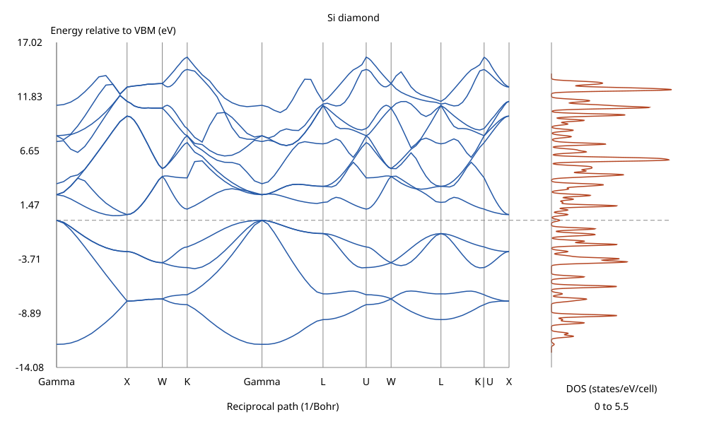

# Open and plot bands and density of states

These commands calculate a self-consistent electron density first, then hold it
fixed while solving at additional wavevectors. You do not need to write code.
You need the built `dft-cli` executable, Python 3 (standard library only), and
a supported norm-conserving pseudopotential. No pseudopotential is distributed
with this example.

1. Open a terminal in the repository folder. Build once:

   ```sh
   export PATH=/opt/homebrew/opt/rustup/bin:$PATH
   cargo build --offline --release -p dft-cli
   ```

2. Save the following as `si-spectra.toml`. Replace the pseudopotential path with
   your actual file. This is a small demonstration, **not a converged materials
   prediction**. The cell vectors are primitive fcc vectors, expressed in Angstrom.

   ```toml
   [system]
   name = "Si diamond"
   lattice_unit = "angstrom"
   lattice_vectors = [[0.0, 2.715, 2.715], [2.715, 0.0, 2.715], [2.715, 2.715, 0.0]]
   [[system.atoms]]
   species = "Si"
   fractional = [0.0, 0.0, 0.0]
   [[system.atoms]]
   species = "Si"
   fractional = [0.25, 0.25, 0.25]
   [pseudopotentials]
   Si = "/absolute/path/to/Si.pz-vbc.UPF"
   [basis]
   ecutwfc_ry = 10.0
   kgrid = [2, 2, 2]
   [xc]
   functional = "lda-pz"
   [scf]
   threads = 4
   nbands = 12
   energy_tolerance_ha = 1e-10
   density_residual_tolerance = 1e-9
   [bands]
   preset = "fcc"
   points_per_segment = 10
   nbands = 12
   max_iterations = 1200
   [dos]
   dos_kgrid = [4, 4, 4]
   nbands = 12
   max_iterations = 1200
   sigma_ev = 0.1
   spacing_ev = 0.02
   ```

3. Calculate both outputs using the **same input file**. Each command runs its
   own deterministic SCF. Only proceed when the command exits successfully:

   ```sh
   target/release/dft-cli bands si-spectra.toml --output-dir si-spectra
   target/release/dft-cli dos si-spectra.toml --output-dir si-spectra
   python3 -I scripts/plot_bands_dos.py si-spectra/bands.csv si-spectra/dos.csv -o si-spectra/figure.svg
   ```

4. Double-click `si-spectra/figure.svg` or open it in any browser. `bands.svg`
   and `dos.svg` are also produced automatically by their respective commands.
   To draw only the bands, omit `si-spectra/dos.csv` from the Python command.
   To use a spreadsheet, import `bands.csv` or `dos.csv` as comma-separated text,
   skipping the initial `#` units comment. The first actual row contains column
   names. Keep the JSON and label sidecars beside the CSV when sharing files.



The [small band CSV](examples/si-bands-dos/bands.csv),
[label CSV](examples/si-bands-dos/bands_labels.csv), and
[DOS CSV](examples/si-bands-dos/dos.csv) accompany this figure. These are actual
rust-dft outputs produced with the **validation pseudopotential of unverified
provenance**, LDA-PZ, a 10 Ry cutoff and coarse grids. No UPF is included. Each
file is below 200 KB. The combined SVG was generated with the original JSON
sidecars, which align the two separately sampled VBM references. The small
example CSVs alone do not preserve those absolute offsets; use the commands
above to regenerate the full metadata bundle.

## Reading the results

The valence-band maximum (VBM) is the largest eigenvalue among the lowest
`number_of_electrons / 2` bands over **the computed sampling**. The conduction-band
minimum (CBM) is the smallest eigenvalue of the next band. The gap is CBM minus
VBM. Every energy column is in eV relative to that sampling's VBM. JSON retains
both absolute values in Hartree and their fractional k coordinates. No smearing
or Fermi level is computed. Overlapping occupied and unoccupied bands are
rejected, rather than given an insulating interpretation.

Path and DOS samplings generally have different sampled extrema. The combined
plot reads both JSON files, verifies a common input hash, and shifts the DOS
onto the bands' absolute VBM reference. Without JSON, CSV energies are assumed
already aligned. Bands are sorted by energy at each point; no symmetry or
orbital-character tracking through crossings is performed.

The DOS uses normalized time-reversal-reduced grid weights and spin degeneracy 2:

```text
D(E) = sum_(k,n) 2 w_k exp[-(E-e_kn)^2/(2 sigma^2)] / (sigma sqrt(2 pi))
N(E) = sum_(k,n) w_k [1 + erf((E-e_kn)/(sqrt(2) sigma))]
```

Here E, e and sigma are in eV; D is states/eV/cell and N is states/cell. Sigma
is a standard deviation, **not** FWHM. Integrated DOS starts at minus infinity,
not at the lower window edge; its full-spectrum limit is twice the number of
bands. A narrow output window omits tails. A coarse energy spacing can miss
peaks, though the analytic integral remains correct. The default window extends
8 sigma beyond the computed spectrum; default spacing is 0.01 eV and sigma is
0.1 eV. No tetrahedron or linear-interpolation alternative is implemented.

## Change the path or grid

Replace `preset` with explicit points in fractional coordinates of the reciprocal
basis of **your supplied cell**:

```toml
[bands]
points_per_segment = 20
points = [
  {label="Gamma", fractional=[0.0, 0.0, 0.0]},
  {label="X", fractional=[0.5, 0.0, 0.5]},
  {label="L", fractional=[0.5, 0.5, 0.5], break_before=true},
  {label="Gamma", fractional=[0.0, 0.0, 0.0]}
]
```

`points_per_segment` means the number of **intervals**; a segment with 20
intervals has 21 points including endpoints. Adjacent connected segments share
one endpoint. Alternatively replace that key with `spacing_inv_bohr = 0.02`
for a maximum segment spacing. Distances use the full reciprocal metric,
including skew cells. `break_before=true` starts a disconnected branch; its
start has the same cumulative distance as the previous endpoint, with no drawn
connecting line. Equal-distance labels are combined as `K|U`.

Presets `fcc`, `bcc`, and `sc` follow the standard cubic paths of
[Setyawan and Curtarolo](https://arxiv.org/abs/1004.2974):

| Preset | Ordered primitive lattice vectors | Path |
| --- | --- | --- |
| fcc | (0,a/2,a/2), (a/2,0,a/2), (a/2,a/2,0) | Gamma–X–W–K–Gamma–L–U–W–L–K / U–X |
| bcc | (-a/2,a/2,a/2), (a/2,-a/2,a/2), (a/2,a/2,-a/2) | Gamma–H–N–Gamma–P–H / P–N |
| sc | (a,0,0), (0,a,0), (0,0,a) | Gamma–X–M–Gamma–R–X / M–R |

A slash denotes a disconnected branch. A positive scale and proper rigid
rotation are allowed. The normalized Gram matrix must match to 1e-10 and the
cell must be right-handed. Conventional cubic cells do not pass fcc/bcc checks.
The code does not reinterpret alternative primitive bases; use explicit points
when a preset is refused. Geometry checks establish the lattice convention,
not the point-group symmetry of an arbitrary atomic motif.

`[dos] dos_kgrid` defaults to twice each SCF `kgrid` dimension (Gamma-only:
2×2×2); the SCF shift is retained. For explicit non-Gamma SCF lists, specify
`dos_kgrid` because a grid cannot be inferred. Only time reversal is used, with
no spatial-symmetry reduction. `window_ev = [-10.0, 10.0]` selects a finite window
relative to the DOS sampling's VBM.

Both tables accept `nbands`, `eigen_tolerance_ha` (default 1e-8 Ha residual norm),
and `max_iterations` (default engine Davidson budget, 400). At least four empty
bands are required; the default is occupied plus max(SCF extra_bands, 4).
`[scf] threads` also controls NSCF. Top bands in a degenerate multiplet can be
slow to converge. This checkout has no per-band Davidson tolerance interface:
**all requested bands remain strict**. A failure names the zero-based k index;
try including more bands to complete the multiplet and/or a larger iteration
budget, without loosening tolerance. The example requests 12 bands. No partial
spectrum is reported as success.

## Portable files and their limits

All non-JSON spectral energies use the stated VBM zero. These are rust-dft
exports in familiar layouts, **not evidence of QE or VASP execution**.

| File | Layout/use | Information it cannot carry |
| --- | --- | --- |
| bands.csv | k_index,distance_inv_bohr,kx,ky,kz,band_1..band_N (eV); initial units comment | Absolute reference, residuals, provenance and branch meaning need JSON/labels |
| bands_labels.csv | label,k_index,distance (1/Bohr); quoted CSV labels | Energies and full geometry |
| dos.csv | energy_eV,dos_states_per_eV_per_cell,integrated_dos; initial units comment | k-resolved eigenvalues, broadening and absolute reference need JSON |
| bands.dat | Whitespace x then all band energies; blank line at branch breaks | Fractional coordinates, labels, weights and provenance |
| bands.dat.gnu | QE-style two columns x (1/Bohr), energy (eV); one band/branch per blank-separated block | QE symmetry labels, overlap tracking, and plotband.x native data; x is explicitly 1/Bohr, not rescaled by 2pi/a |
| dos.dat | Whitespace energy, DOS, integrated DOS, with `#` units comment; QE-style total-DOS columns | QE Fermi energy or a claim of QE smearing/integration |
| bands.agr, dos.agr | Grace project directives, `@target G0.Sn`, `@type xy`, numeric pairs, `&` terminators | Full physical metadata; DOS project plots DOS only, not its integral; band labels remain in sidecar |
| EIGENVAL | Six-line VASP-style header; NELECT NKPOINTS NBANDS on line 6; blank line, fractional k and zero path weight, then index/eV/occupation for each band; ISPIN=1 | Lattice, symmetry and VBM reference metadata; zero path weights are not a BZ quadrature; no restart or VASP provenance |
| DOSCAR | Six-line VASP-style header, no partial DOS; Emax Emin NEDOS **0** 1 on line 6, followed by energy/DOS/integral triples | The nominal Fermi slot contains a documented VBM-zero placeholder, **not a Fermi energy**; no projected DOS, no VASP smearing semantics |
| bands.json, dos.json | Absolute VBM/CBM, k positions, gap, electron/band counts, cell, cutoff, functional, residuals, version, input/UPF hashes, weights; path or Gaussian metadata | Wavefunctions and a reusable SCF restart |
| bands.svg, dos.svg, figure.svg | Browser-readable vector plots | Machine-readable physical provenance; preserve JSON when sharing |

Examples for other plotting programs:

```sh
gnuplot -persist -e "plot 'si-spectra/bands.dat.gnu' using 1:2 with lines"
gnuplot -persist -e "plot 'si-spectra/dos.dat' using 1:2 with lines"
xmgrace si-spectra/bands.agr
```

Format references are the public [QE bands.x output description](https://www.quantum-espresso.org/Doc/INPUT_BANDS.html),
[Grace guide](https://plasma-gate.weizmann.ac.il/Grace/doc/UsersGuide.html),
[VASP EIGENVAL description](https://vasp.at/wiki/EIGENVAL),
[VASP team's EIGENVAL layout explanation](https://vasp.at/forum/viewtopic.php?t=18244),
and [VASP DOSCAR specification](https://vasp.at/wiki/DOSCAR). No QE source was
read. An independent Python reader in `crates/dft-cli/tests/read_spectra.py`
checks every exported numeric layout against CSV, header counts, occupations,
weights, branch blocks and SVG XML. This does not claim testing with installed
VASP, QE, Grace or gnuplot applications.

Outputs with the named files are overwritten on success; other files remain.
Existing symlinks, hard links and input aliases are refused before computing.
Writes are not a multi-file transaction. Failed runs may leave older files or
partial output: check exit status rather than trusting file existence. Codes:
1 invalid input, 2 UPF parse failure, 3 SCF iteration exhaustion, 4 numerical or
noninsulating failure (including NSCF), 5 I/O/plot failure. A missing Python 3
can leave numeric bands files written before SVG generation fails.

## Measured demonstration and reproduction

Run on 2026-11-03 with rust-dft 0.1.0 and the input above; the executed input used
`/Users/mino/Develop/rust-dft-wt/pseudo/Si.pz-vbc.UPF`. Its exact input SHA-256 was
`90402c8835cc83d3062605964ab7c8481f81c349c647e41a9afe29500344170e`.
The UPF SHA-256 is
`e8d933754cd51c6bb4b2a809151f89e0647e53d878bab88d26e1b5a5d68d5217`;
full convergence metadata is recorded in the generated JSON.
The SCF converged in 13 iterations to -7.795472943213 Ha. The path contains
102 points; the 4×4×4 DOS grid contains 36 time-reversal representatives.

| Measured quantity | Value |
| --- | --- |
| Path VBM | 0.2350217241642435 Ha at Gamma (0,0,0), index 0 |
| Path CBM | 0.2512627595616321 Ha at (0.4,0,0.4), index 8 |
| Sampled indirect path gap | 0.44194108723310443 eV |
| Sampled DOS-grid gap | 0.546115513 eV |
| DOS CBM | 0.25509109910052863 Ha at (-0.5,-0.5,0), index 33 |
| Largest path band residual | 9.9574372274311e-9 Ha |
| Largest DOS band residual | 8.849851021600454e-9 Ha |
| DOS energy samples | 1337 |
| DOS window integrated states | 24.000000000 states/cell (12 bands, spin factor 2) |
| Separate Si Gamma NSCF vs SCF maximum eigenvalue difference | 1.0737488675971463e-10 Ha |

These are coarse LDA demonstration values from a pseudopotential with unverified
provenance. The differing path/grid gaps show sampling limitations, not numerical
uncertainty estimates. No converged physical gap or QE agreement is claimed.
Claude will perform the separate QE 7.6 bands comparison remotely after merge.

```sh
scripts/check.sh
python3 -I -m unittest discover -s scripts/tests
DFT_SI_UPF=/absolute/path/to/Si.pz-vbc.UPF cargo test --offline --release -p dft-engine --test nscf real_si -- --ignored --nocapture
```

The synthetic SCF-grid comparison checks 1e-8 Ha agreement; measured maximum
was 5.5677684684951601e-14 Ha. Threads 0,1,2,4,9 produce exactly equal synthetic
eigenvalues, and threads 1/4 exactly equal Si Gamma eigenvalues. The synthetic
Gaussian trapezoidal integral is 3.9999999999999978 states/cell for an expected
4, within the stated 1e-6 tolerance. Heavy real-Si testing is ignored by the
normal debug gate and requires the environment variable above.
