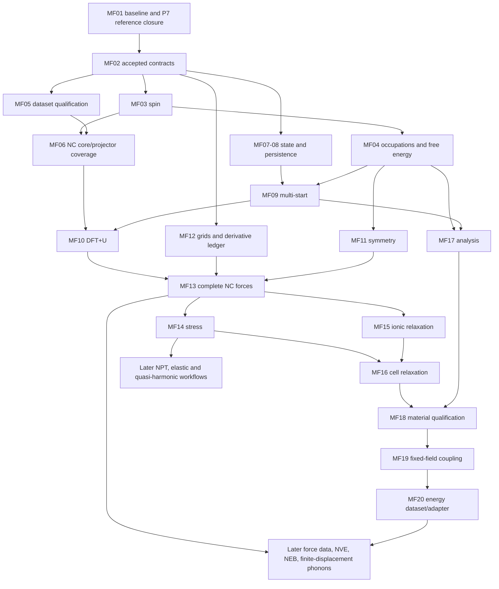

# Master plan proposal

| Scope | Authority | Companion |
| --- | --- | --- |
| Seven phases, twelve architecture decisions and twenty prerequisite-ordered proposed tickets | Proposal only; does not authorize expansion of current scope | [Feature matrix](../research/dft-feature-matrix.md) |

The ordering targets transition-metal oxides, cathodes, defects, alloys and magnetic materials, followed by multiscale coupling and AI/MLIP data generation. Existing accepted ADRs remain authoritative. New ticket names below are proposals, not issued work orders.

## Baseline and decision authority

Snapshot: `318b1c2`, inspected 2026-11-04. The [matrix evidence map](../research/dft-feature-matrix.md#verified-engine-evidence-map)
links the implementation behind each claim. This engine has complex NC plane-wave
SCF, weighted k points with time-reversal reduction, LDA-PZ and library-backed
PBE, fixed insulating occupations, audited energies, scoped CPU k/band workers,
and structured result export. It does not yet have spin, smearing, derivatives,
state reload, PAW/USPP, MPI or GPU. ADR 0019 authorizes an optional MKL implementation;
the inspected numerical source does not yet select it. PBE implementation and
synthetic tests exist; the real-Si PBE comparison is still deferred in ADR 0018.
The older architecture/P7 prose is therefore not a reliable implementation ledger.

This proposal merges P7, ESLE, coupling and performance ordering without treating
proposed ADRs 0016/0017 as accepted or expanding AGENTS.md scope. P8D owns the
XC/many-body depth; P8E owns usability, robustness and workflow depth. Their named
documents were absent when inspected. Queue entries below are integration slots:
reuse their eventual tickets rather than creating a competing implementation.
Only these two P8F documents are owned; no issue JSON, session registry, README,
ADR or actual ticket file is modified. Session registration belongs to the
invoking delegate wrapper; recursively launching another Codex run is unnecessary.

## Architecture decisions to settle before implementation

Each recommendation is a proposal. A later ticket must enumerate exact owned
files and receive ownership of frozen contracts before editing them. Keep public
legacy Gamma APIs additive during this migration.

| Decision | Verified support or blocker | Options | Recommendation and proof obligation |
| --- | --- | --- | --- |
| D1 Spin and ElectronicState | E4 scalar `Array3<f64>`, common 2/0 occupation vector; ElectronicState is only proposed | Separate unrelated spin solvers; or tagged scalar/collinear/spinor representation | Tagged spin mode with explicit spin, band and k axes; collinear channels first, future 2x2 density represented by n and three magnetization components. State fingerprints include spin frame, constraints and occupations. Test zero-magnetization reduction and charge/moment sums; do not enable spinors by merely doubling band count. |
| D2 Occupations and certificate | E4 explicitly rejects partial occupations; occupied-only residual/gap gates | Patch fractional numbers into density; or an occupation/free-energy policy | Central policy returns occupations, chemical potential, entropy and electron-count residual. Ledger distinguishes E, F=E-TS and later grand potential; certify the same finite-T SCF map with adequate empty states. Preserve insulating policy and its rejection behavior. P8D owns methods, P8E convergence UI. |
| D3 Symmetry | E6 only k/-k reduction, no space-group density symmetrization | Full meshes forever; geometry-only reduction; magnetic-model-aware reduction | Keep full-grid oracle; represent operation, reciprocal mapping, phase, weight and spin action together. Reduce only under symmetries of the actual field/magnetic state; symmetrize density consistently. Disable invalid time reversal for magnetic/SOC cases. Compare full/reduced energies and densities. Large grids can run before symmetry, at higher cost. |
| D4 Pseudopotentials and overlap | E2 rejects NLCC, USPP, PAW, SOC; E1 ordinary Hermitian eigenproblem | Force all data into NC structs; or tagged NC/augmented variants | Keep NC operational path; reserve typed projector channels, relativistic labels, augmentation and overlap capabilities. Future USPP/PAW needs Hc=epsilon Sc, S-orthogonality, augmentation density and complete energy/derivatives. Do not implement empty augmentation machinery now. Qualify NC first, including NLCC and semicore if needed. |
| D5 Grid ownership | E1 wavefunction/density bases exist; Hamiltonian uses concrete FFT/grid buffers | One global implicit grid; or explicit grid roles and transfers | Name wavefunction, density and later augmentation grids with dimensions, cell, origin, cutoff and normalization. Own reusable plans/workspaces per worker; explicit adjoint-consistent interpolation/restriction. Test charge conservation, Parseval and variational derivatives. Dual reciprocal cutoffs today are not an arbitrary dual-real-grid engine. |
| D6 Energy and derivatives | E5 direct/band audit exists; no force/stress API | Add force terms ad hoc; or contribution ledger with derivative availability | Assign every term a named energy owner and derivative capability. Start NC stationary functional; include nonlocal projector, Ewald, XC/core and future Hubbard contributions. Report unavailable derivatives explicitly. Central displacement/strain differences at several step sizes plus residual convergence; include Pulay/cutoff effects for stress. |
| D7 Meta-GGA/hybrid operators | E3 XC returns local XcGrid; solver trait has apply/apply_block, E1 local+NC operator | Overload scalar Vxc; or capability-dispatched local/differential/nonlocal contributions | Preserve local LDA/PBE fast path. Meta-GGA needs kinetic-energy density and differential operator contributions; hybrids need occupied-subspace exchange and memory ownership. Generalize at assembly boundary, keep solver operator abstraction. Direct exchange oracle before ACE; inspect derivatives separately. |
| D8 Units | Typed Bohr/Hartree inputs exist, many arrays/ledger fields are f64 | Convert units everywhere; or typed boundaries with documented array semantics | Keep atomic units inside; add force (Ha/Bohr), stress (Ha/Bohr^3), field and entropy semantics at contracts. Validate shape, frame and normalization at import. Never mix electron potential energy with electrostatic potential. |
| D9 Persistence | E7 exports density/results but no compatible restart | Treat results.json as checkpoint; or immutable versioned state envelope | Follow ESLE: model/basis/environment fingerprints, ordered k/band/spin metadata, hashes and explicit schema, payload-first manifest-last writes. Density restart first, orbital retention later. Distinguish exact replay from warm transfer; reject incompatible/corrupt data. No serialization in kernels. |
| D10 Threads/MPI | E8 scoped k/band ownership, deterministic ordered reductions | Uncontrolled nested libraries; or one scheduler budget and explicit distributed ownership | Preserve total worker budget and independent scratch, deterministic reference fold, global k identities. MPI later distributes k first, bands/grids only on profiling evidence. Backend threading remains controlled. Specify reproducibility within/across backend and rank layouts separately. |
| D11 GPU-neutral numerics | Fft3d/LinearOperator exist; host Array3/ComplexMatrix and concrete FftPlan3d remain | Assume current traits are device-ready; or plan buffer residency and batched operations | Use P7C design gate for owned buffers, device/host transfer, synchronization, workspace reuse, error and precision policies. Keep backend details in dft-numerics (ADR 0001); MKL compile-time choice follows ADR 0019, not a runtime plugin redesign. No device code without profiling and authorization. |
| D12 Coupling and observables | E5/E7 no field/driver implementation; ADR 0017 proposed | Universal EnergyForceCalculator; or typed capability/request/result contracts | Adopt separate inner SCF and outer coupled status, explicit energy ownership and immutable environment identity. Start neutral fixed-N exact-grid electron-energy field only after user decision; constant-potential and density-dependent environments require new functionals. Force datasets wait for complete derivatives. |

## Dependency graph and material priorities

Arrows are prerequisites, not suggested simultaneous work. Ticket numbers below
are topologically ordered. Approval and reference availability are real gates.

Spin precedes magnetic DFT+U; qualified NC plus NLCC/semicore coverage is the first
route to 3d oxides, with PAW conditional on demonstrated accuracy/cost limitations.
Smearing precedes metallic alloy qualification; forces precede relaxation and
finite-displacement phonons; stress precedes cell/NPT work. Symmetry is an
optimization and correctness contract, not a mathematical prerequisite to using
large unreduced meshes. SOC needs spinors and relativistic projectors before
magnetic anisotropy claims. Charged defects need a charge/background policy,
dielectric/potential references and size extrapolation; neutral defects can
precede them. Hybrid/meta-GGA benchmarks follow occupied-state/grid contracts.

For target materials the shortest useful milestone is a validated spin-PBE NC
oxide and a smeared simple metal, followed by DFT+U branch comparisons. Cathode
voltages need consistent relaxed phases/reference energies, not just a U flag.
Alloy sampling/SQS, phase diagrams and battery workflow orchestration belong in
external tools. P8E should expose failures and provenance before high-throughput
campaigns. ESLE should retain failed starts and compare only matching model
fingerprints; similar energies alone never establish state identity.

## Phases, entry/exit gates and validation oracles

| Phase | Entry gate | Work integrated from existing plans | Exit evidence and oracle |
| --- | --- | --- | --- |
| 0 Baseline closure | Current repository + real reference inventory | P7A/R6 closure audit, P7B real PBE comparison, P7C design; performance baseline | Confirm already-stored k evidence rather than redo it; fill only missing PBE comparison via Claude/dev08. Preserve existing Si and mathematical tests; exact inputs, versions and hashes. PBE using an LDA UPF override is consistency evidence, not material validation. |
| 1 State and materials foundation | Phase 0; explicit scope approval | D1–D9, spin, smearing, NC qualification, ESLE B/C | Spin zero-limit and polarized analytic XC; electron/entropy identities; real NC O/3d/metal qualification; save/load integrity and restart noise floors; multi-start failure registry. MF02–09. |
| 2 Correlated static structures | Phase 1 with stable state fingerprints | P8D DFT+U; symmetry, grids, derivative framework | Hubbard projector/gauge and variational tests; all existing residual certificates preserved; full/reduced symmetry agreement. Compare identical U/projector conventions, never only matching a literature gap. MF10–12. |
| 3 Structural materials | Phase 2 | Forces then stress, ionic then cell relaxation, ESLE D continuation, P8E analysis | Force and strain finite differences over converged cutoffs/k meshes; acoustic/translational invariance; independent relaxed structures/energetics. Frozen-cell and changing-basis stress distinguished. MF13–18. |
| 4 Coupling and data | Phase 3 + each coupling gate approved | ADR 0017 gate 2, typed observables, external adapters | Constant-field shift/sign/double-counting tests; unchanged zero-field path; schema and idempotence checks. Energy-only records first. Coupling force derivatives and ordinary force coverage gate MLIP force records. MF19–20 plus follow-up tickets. |
| 5 Dynamics, defects and response | Qualified derivatives and workflow contracts | NEB, NVE then thermostats/barostats, finite-displacement phonons; dielectric/charged-defect policy | Timestep/SCF-dependent NVE drift; converged saddle barriers; acoustic modes and displacement convergence; cell-size extrapolation and defect charge/reference checks. QHA after phonons at volumes. DFPT after perturbation/response operators. |
| 6 Advanced magnetism/XC/scale | Specific material need and measured bottleneck | P8D noncollinear/SOC, meta-GGA/hybrid, dispersion; optional PAW; MPI/GPU; later GW/BSE/RPA/cRPA/DMFT interfaces | Each method gets independent analytic/small-system oracles and matched external runs. PAW requires overlap/augmentation and derivatives; exchange must pass direct oracle before ACE. No universal release date. |

Performance is a track across every phase, not an excuse to postpone correctness.
Read [performance rules](../performance/README.md), profile before modifying a hot
path, and compare `scripts/bench_scf.py` with the applicable recorded baseline:
energy within 1e-12 Ha, bit-identical density for overhead-only changes. Record
backend, threads, machine and before/after evidence in the optimization log under
a separately owned implementation ticket. Physics extensions require new matched
oracles; the overhead tolerance is not a universal error allowance for new physics.
MKL and P7C may advance alongside Phase 0 only without blocking reference closure
or changing baseline semantics. Current P7 implementation is not to be rewritten.

## First twenty proposed tickets

MF identifiers are local proposal IDs, not existing repository task IDs. Queue in
this order; independent branches can later be scheduled separately by the
orchestrator. Owned **areas** are proposed scopes, not present authorization;
Claude must resolve exact files and frozen ownership when issuing each ticket.
All implementation gates additionally require `scripts/check.sh`, appropriate
release-only tests for slow cases, stored evidence, and the generated README
validation block when new verified numerical evidence is added.

| Order / proposed ID | Title and proposed owned areas | Prerequisites | Acceptance gate | Agent-days |
| --- | --- | --- | --- | --- |
| 01 / MF01 | Close P7 evidence and reconcile status: validation docs, reference bundles, P7C note | Existing P7A/P7B; remote reference availability | Audit R6; complete missing PBE/QE comparison with hashes/version/override labels; reconcile stale architecture prose; accept GPU design separately, no GPU code | 2–4 |
| 02 / MF02 | Approve spin/occupation/state/grid/derivative contracts: ADRs, architecture docs, schema proposals | MF01; user scope decisions below | D1–D12 reviewed with concrete types, units, migration and invalid-combination tests specified; coordinate P8D/P8E; no placeholder implementation counted | 3–5 |
| 03 / MF03 | Collinear spin SCF: physics XC/density, engine, CLI inputs/tests | MF02; authorized spin XC library scope | n-up/n-down and magnetization conservation, unpolarized limit, polarized analytic derivatives and matched small-system reference; spin-aware symmetry disabled until valid | 6–10 |
| 04 / MF04 | Metallic occupations/free energy: engine policy/ledger, solver certificate, CLI | MF03 | Fermi-Dirac first; number root and entropy tested, T-to-zero insulating limit, empty-band convergence; matched simple-metal k/T study; fresh certificate uses occupation map | 5–9 |
| 05 / MF05 | Dataset provenance and O/3d/metal selection: UPF qualification tests/docs, metadata manifests | MF02; dataset access/license review | Record hashes/licenses/valence/XC/semicore; parse supported files and produce explicit blockers for unsupported ones; no UPF committed; includes Mg/O option for ESLE | 3–6 |
| 06 / MF06 | Required NC coverage and real material checks: UPF/radial adapters, physics XC/core, engine tests | MF03, MF05 | Implement only demonstrated gaps, including NLCC if selected files require it; normalized atomic-density adapter for ESLE; derivative-consistent core XC; O/3d cutoff and ghost/transferability checks. Stop/replan for unsupported format scope | 7–14 |
| 07 / MF07 | Additive density start/state identity: engine state/compatibility/run_from, ESLE docs | MF02 | Existing run unchanged; model/basis/spin/occupation/environment identity; density charge/shape checks, warm start versus replay distinctions; default Gamma regression | 3–5 |
| 08 / MF08 | Immutable state persistence: CLI state I/O and engine metadata tests | MF07 | Manifest-last writes, payload hashes, version and incompatibility rejection, save/load bit identity; restart repeatability/noise measured; orbital payload explicitly optional/deferred | 3–6 |
| 09 / MF09 | Deterministic multi-start and state comparison: engine exploration, CLI registry | MF03, MF04, MF06, MF08 | Uniform/perturbed/atomic/restarted starts, failure preservation, calibrated density/moment metrics, no energy-only merging; repeatability across permitted seeds/threads | 4–7 |
| 10 / MF10 | First DFT+U functional and branch benchmark: P8D slot, physics projectors/ledger, engine | MF04, MF06, MF09 | One explicit U convention with occupation-matrix/gauge tests, energy-potential derivative check and matched reference; compare AFM/FM starts with same model; no claim of U-force support yet | 8–15 |
| 11 / MF11 | Model-aware symmetry: geometry operations/k maps, physics density symmetrization | MF02, MF03, MF04 | Full/reduced equality for nonmagnetic and allowed collinear cases; shifted/skew grids, weights, phases; field/SOC/constraint combinations reject unsafe reduction | 5–9 |
| 12 / MF12 | Grid roles and derivative ledger: basis/grid metadata, physics/engine contribution contracts | MF02 | Current single-grid path unchanged; adjoint transfer and charge tests; enumerate every energy derivative and unavailable term; force/stress conventions fixed before kernels | 4–7 |
| 13 / MF13 | Complete ordinary NC forces: physics local/nonlocal/Ewald/XC/U derivatives, engine result | MF06, MF10, MF11, MF12 | Several-step finite differences with SCF/k/cutoff convergence, translation/net-force tests; covers released spin/PBE/U/NLCC combinations or rejects each explicitly; no silently incomplete forces | 10–18 |
| 14 / MF14 | NC stress and strain audit: physics/engine stress, CLI units/tests | MF13 | Energy-strain derivatives, signs/shear/volume tests, cutoff/Pulay convergence; free-energy derivative for smearing and U/core terms included; matched reference | 8–14 |
| 15 / MF15 | Ionic relaxation and constraints: engine observable API, external/CLI driver | MF08, MF13 | Converges a small distorted structure with energy/force criteria; constraints, failed SCF and restart tested; exact state compatibility separated from warm transfer | 4–7 |
| 16 / MF16 | Cell relaxation and ESLE continuation: geometry/driver/state transfer | MF09, MF14, MF15 | Cell+ionic convergence, charge-preserving warm transfer, fresh-start comparison and branch tracking; constrained cells and invalid transforms fail explicitly | 5–9 |
| 17 / MF17 | Bands/DOS/PDOS and observables: P8E slot, CLI analysis and projection metadata | MF04, MF08, MF09 | Frozen-density band path and DOS normalization, explicit energy reference; projector/PDOS convention and incomplete projection weights exposed; compare independent small case | 4–8 |
| 18 / MF18 | Target-material qualification bundle: reference tests, convergence docs, generated figures | MF10, MF16, MF17 | One 3d oxide, one metallic alloy/simple-metal precursor and one neutral defect: consistent references, magnetic branches, cutoff/k/size/force convergence; cathode phase comparison only if all required species qualified | 6–12 |
| 19 / MF19 | Neutral fixed-field coupling: physics field/ledger, engine contracts, CLI metadata | MF08, MF12, MF18; coupling gate 2 approval | Zero-field regression; electron-energy field sign and constant-shift tests, both energy forms and certificate; exact-grid/origin rejection; separate electronic partial and coupled total | 5–9 |
| 20 / MF20 | Energy-only workflow/data adapter: P8E slot, external adapter/CLI schema, dataset tests | MF17, MF18, MF19; coupling gate 4 approval only if lifecycle driver included | Immutable model/environment identity, failures and inner/outer statuses, idempotent result ingestion, units/hashes; no force labels until separate coupling-derivative gate passes | 4–7 |

MF19 is a fixed-field energy/density implementation, not completion of coupling
gate 3 derivatives. MF20's initial scope is export/ingestion of evaluated results;
a live external coupling driver remains blocked by coupling gate 3 and its own
approval. This distinction preserves the existing coupling roadmap's order.
Likewise MF13 ordinary U/NC forces do not imply derivatives of a future field,
solvent, hybrid or PAW functional. Follow-up tickets must extend the ledger before
those combinations can generate force training data.

## Effort assumptions and later-series estimates

An agent-day is one focused implementer day with local tests and one review
iteration, not an elapsed-day promise or autonomous correctness guarantee.
Ranges assume existing dependencies are available offline, one architect reviews
interfaces, fixtures are small, public formulas are accessible, and the user or
Claude supplies licensed datasets and remote oracle runs. They exclude queue
waits, hardware procurement, licensing negotiations and failed scientific models.
Sum of the first twenty ranges: **99–181 agent-days**. Shared review and references
limit parallel speedup; do not divide the total by the number of agents. Split
large entries into narrow owned-file subtickets after the contract gate.

| Later series | Prerequisites | Rough agent-days | Gate/oracle |
| --- | --- | --- | --- |
| NVE and NEB/finite-displacement workflows | MF13–18, adapter | 8–18 | Drift versus timestep/SCF tolerance, saddle convergence, acoustic modes |
| Charged defects and dielectric corrections | MF14/18, approved charge policy, response solver | 15–30 | Potential alignment, dielectric convergence, supercell extrapolation |
| Noncollinear/SOC and anisotropy | D1/D3/D4, qualified relativistic datasets | 15–30 | Spin rotation limits, SOC splitting and tight anisotropy convergence |
| Dispersion and meta-GGA | P8D contract, D5–D7, derivative ledger | 12–25 | Functional derivatives, force/stress consistency and matched references |
| Exact exchange/hybrid then ACE | Occupied-state storage, D7, memory profile | 20–40 | Direct small-system exchange; compressed operator residual and energy |
| PAW or USPP (one first) | Evidence NC route insufficient, generalized overlap/augmentation ADR | 40–80+ | S-orthogonality, charge/energy and all derivative terms, qualified datasets |
| DFPT and polar lattice response | Perturbation operator, derivatives, symmetry | 25–50 | Finite-difference oracle, sum rules and dielectric/Born tests |
| MPI/GPU execution | P7C/ADR 0019 reconciliation, measured CPU bottleneck | 20–45 per backend | Backend/thread/rank equivalence and reproducible profile; no speed target invented |
| RPA/GW/BSE/cRPA/DMFT interfaces | P8D review, response/Wannier/projector infrastructure | 30–90+ per selected method | Method-specific small-system and independent-code checks; separate research proposal |

These are planning estimates with weak empirical evidence: this repository has
not delivered these feature series before. PAW, response and many-body ranges
have especially high uncertainty. Prefer interface/export interoperability for
rare research methods to an unbounded promise to reproduce every code.

## User decisions required before future implementation

No decision is needed to review or store this proposal. The following gates must
be decided when the corresponding implementation is queued; recommendations are
not inferred approvals.

| Gate | Options | One recommendation |
| --- | --- | --- |
| U1 Scope after P7 | Keep Si-only research baseline; or admit spin/smearing/NC forces/stress | Admit the staged MF02–18 materials scope after baseline closure, with separate ownership tickets |
| U2 First benchmark set | Broad chemistry immediately; or a small oxide/metal/neutral-defect suite | Select one O/3d pair plus one simple metal and neutral defect, with licensed datasets before promises |
| U3 Dataset strategy | PAW-first; or qualify NC including core/semicore then revisit | NC-first; trigger PAW only on measured accuracy/cost limitations |
| U4 Method priority | Hybrids/SOC first; or collinear spin/smearing/U then derivatives | Collinear spin/smearing/U and complete derivatives first for target cathodes/oxides |
| U5 State retention | Full orbitals always; or density-first plus optional orbitals | Density-first with explicit warm-restart guarantee and versioned optional orbitals |
| U6 Coupling gate 2 | Electron-only field; or simultaneous ion/environment model | Neutral fixed-N exact-grid electron-energy field, retain/record its mean, reject incomplete coupled totals |
| U7 Data and adapter policy | Immediate force/active-learning pipeline; or validated energy export first | Energy-only provenance-preserving export, force records after ordinary and coupling derivatives are certified |
| U8 Scale investment | GPU/MPI immediately; or profile-guided backend work | Keep pure Rust default, honor optional MKL scope, approve GPU/MPI only after profiling |

Library additions remain subject to license, maintenance and Apple Silicon review;
Claude fetches/manages dependencies. No task here authorizes local QE installation,
remote changes, dataset redistribution or reading external implementation source.

## Limits of this document

Feature support evidence is catalogued, including explicit unknowns, in the
[matrix](../research/dft-feature-matrix.md#limits-of-this-document). This plan is
engineering judgment, not an accepted release schedule. Snapshot-specific source
inspection overrides stale prose but does not prove absence in future branches.
P8D/P8E synchronization is outstanding because their deliverables were absent.
Detailed force, stress, response and material tolerances must be justified and
frozen before implementation from discretization studies and independent oracles;
no tolerance is loosened to fit another code. The existing energy benchmark
threshold does not certify force datasets. Neither database licenses nor all
cross-feature combinations have been verified. This ticket adds no numerical
implementation and produces no new physical reference result.

## Verification of this documentation change

Executed in this worktree on 2026-11-04:

| Command/check | Exit code | Observed result |
| --- | --- | --- |
| `scripts/check.sh` | 0 | PASS build, test, fmt and clippy |
| `python3 -I -m unittest discover -s scripts/tests` | 0 | 113 tests passed in 6.581 s, including generated README/figure freshness checks |
| Inline Python document audit | 0 | Local link targets exist; 77 matrix capability rows have all code/engine/priority columns; twenty unique ordered tickets; explicit prerequisites precede dependents; effort sum 99–181 agent-days |

Python emitted existing unclosed-file ResourceWarnings; the suite still exited
0. No new external reference run was made. Numerical output from the Python
suite is a regression of stored evidence, not new P8F physical evidence.
README/figures are unchanged because this is a documentation-only ticket and
their freshness tests passed. Artifact registries remain outside OWNED_FILES.
The pre-existing tracked `.DS_Store` modification was not changed by this work.
The two new documents are left uncommitted for architect/user review.

## References

- [Capability matrix and public documentation references](../research/dft-feature-matrix.md#references), 2026 survey; eleven code families and explicit evidence limitations.
- [P7 plan](../p7-plan.md), 2026; [validation record](../validation.md), existing measured references, not new runs in this ticket.
- [ESLE roadmap](esle.md), [ElectronicState design](../architecture/electronic-state.md), [ADR 0016](../decisions/0016-esle-layering.md), 2026, proposed design.
- [Coupling roadmap](coupling.md), [scientific coupling](../architecture/scientific-coupling.md), [ADR 0017](../decisions/0017-coupling-commitments.md), 2026, proposed design and user gates.
- [ADR 0018: PBE](../decisions/0018-pbe-via-xcx.md), 2026, accepted with implementation results and deferred real-Si reference.
- [ADR 0001: backend isolation](../decisions/0001-numerical-backend-isolation.md), 2026, including subsequent scoped-thread notes; [ADR 0019: optional MKL](../decisions/0019-optional-mkl-backend.md), 2026, accepted for implementation.
- [Performance rules](../performance/README.md), [baseline](../performance/baseline.json), [optimization log](../performance/optimization-log.md), 2026.
- P8D (XC/many-body) and P8E (workflow/robustness) tickets: companion coordination required; named output files absent at inspection.
